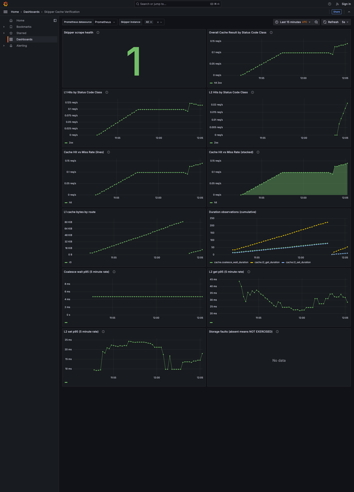

# Verification results — 2026-10-22

All traffic was synthetic and local. Mock origin: `mccutchen/go-httpbin:v2.15.0`;
Valkey: `valkey/valkey:9-alpine3.23`; Prometheus: `v2.55.1`; Grafana OSS: `11.3.0`.
One host Skipper process was active per run, with the same force-cache route,
real HTTP transport, Valkey L2 and unique UUID keys. No cache flush was used.

## Wire behavior

| Revision | UTC start | Cold + warm origin calls | 10-request cold burst origin calls | After warm | `Vary: *` 3 requests | Overall |
|---|---|---:|---:|---:|---:|---|
| PR4365 `2e891d33f14a121ce149284ace527116e3897af5` | 11:40:11 | 1 | **1** | **1** | 3 | **PASS** |
| Unfixed parent `790d827ec18f7ecbb560e43cfa99e91949de0a4b` | 11:46:48 | 1 | **10** | **10** | 3 | **FAIL, expected negative control** |
| PR4364 `6a217f4f65e9966c4e18d9c3cad2e069fc5893b1` | 11:47:16 | 1 | **10** | **10** | 3 | **FAIL, expected without PR4365** |

Every returned response was checked for HTTP 200 and the requested path/query;
successful fixed burst responses and their warm response had identical JSON
bodies. `Vary: *` response headers and JSON body fields were checked. For the
negative runs, amplification fails before requiring identical burst bodies
(independent origin responses need not be identical). Origin logs were scoped
by each case's unique run ID, not aggregate before/after log tails.

The harness itself returned exit status **1** for the two expected failures.
The successful #4365 run returned **0**. JSON evidence:
[PR4365](pr4365.json), [unfixed control](control.json), [PR4364](pr4364.json).
Five harness unit tests also passed, including wrong status/path/query,
request failure propagation and origin-amplification failure.

Commands, run from the e2e repository root against the corresponding **clean**
checkout selected by the launcher:

```bash
./run-skipper.sh "$SKIPPER_CHECKOUT"
./verify-coalescing.sh --label pr4365 \
  --sha 2e891d33f14a121ce149284ace527116e3897af5 --output results/pr4365.json
# Switch the process before each next command; do not move a working branch.
./verify-coalescing.sh --label unfixed-parent-control \
  --sha 790d827ec18f7ecbb560e43cfa99e91949de0a4b --output results/control.json
./verify-coalescing.sh --label pr4364-without-pr4365 \
  --sha 6a217f4f65e9966c4e18d9c3cad2e069fc5893b1 --output results/pr4364.json
```

The unfixed control used a separate detached worktree under ignored `.runtime/`,
at #4365's parent. No Skipper branch was moved or modified. No combined
Skipper build or cherry-pick was used.

## Targeted Go race tests

At exact PR4365 HEAD, **two real-HTTP proxy integration tests passed**:
the new concurrent cold-miss regression and existing `Vary: *` regression.
These use an `httptest` origin, proxy and real Go HTTP client, not a stubbed
`fetch`. The live wire harness independently demonstrates the unfixed behavior.

```bash
go test -race ./filters/cache \
  -run '^(TestProxy_Coalesce_RealFetch_ConcurrentColdMiss_SingleBackendCall|TestProxy_L1Cache_VaryStar_NeverCached)$' \
  -count=1 -v
```

At exact PR4364 HEAD, **11 targeted tests passed**, including coalesce wait
observations, L2 get/set duration observations, labeled result/error paths,
corrupt JSON and delete failure behavior:

```bash
go test -race ./filters/cache \
  -run '^(TestValkeyStorage_RecordsGetSetDuration|TestCacheFilter_Coalesce_RecordsWaitDuration|TestValkeyStorage_LabeledMetrics_.*|TestL2Storage_Get_CorruptJSON_ReturnsError|TestLRUStorage_Get_CorruptJSON_RecordsStorageError|TestCacheFilter_LabeledMetrics_StorageError)$' \
  -count=1 -v
```

Saved successful output: [PR4365 Go tests](go-pr4365.txt),
[PR4364 Go tests](go-pr4364.txt). PR4364 fault/duration tests use controlled
stubs/metric collectors; those are not presented as live exporter fault tests.
No full repository suite, benchmark or nginx comparator was run.

## PR4364 observability

Snapshot at **11:54:25 UTC**, running unmodified
`6a217f4f65e9966c4e18d9c3cad2e069fc5893b1`:

| Assertion | Observed | Outcome |
|---|---|---|
| Prometheus Skipper scrape | `up{job="skipper-local"} = 1` | PASS |
| Cache result samples | `hit=13`, `l1_hit=13`, `coalesce_error=28`, `l2_miss=28` | PASS, negative-control error expected |
| L1 bytes | `19316`, route `r0` | PASS |
| Coalesce wait histogram | count `28`, sum `0.0008090430000000001` seconds | PASS |
| L2 get histogram | count `69`, sum `0.4272823310000001` seconds | PASS |
| L2 set histogram | count `25`, sum `0.11541062499999999` seconds | PASS |
| Coalesce wait p95 expression | `0.00475` seconds | PASS, coarse bucket estimate |
| L2 get p95 expression | `0.03541666666666665` seconds | PASS |
| L2 set p95 expression | `0.020499999999999994` seconds | PASS |
| Storage errors by backend/op | no series | **NOT EXERCISED live**, not a verified zero |

Raw [metric samples](metrics-samples.txt) and
[per-panel query responses](metrics.json) are committed. All eight expressions
were executed successfully against both Prometheus and Grafana's actual
datasource proxy; seven returned expected finite samples, the fault panel was
explicitly empty. Do not sum `hit` and `l1_hit` as distinct requests: these are
different levels of instrumentation.

```bash
python3 verify-metrics.py \
  --sha 6a217f4f65e9966c4e18d9c3cad2e069fc5893b1 --output results/metrics.json
CHROME=/path/to/chrome node verify-browser.mjs
```

Headless Chrome loaded the provisioned dashboard and waited for all eight
panel queries. A screenshot was inspected visually: scrape health is 1; result,
L1-byte, histogram-count and all three latency plots contain data; the storage
fault plot explicitly says **No data**. No missing-datasource error.

The screenshot below is the newer twelve-panel dashboard described in the
follow-up section; the original eight-panel numeric snapshot above is retained.



The datasource is templated in the export. The local dashboard remains
`http://localhost:3000/d/ag1x69aba3qpse/skipper-cache-verification`.
Grafana is anonymous **Viewer** and all services are ClusterIP with loopback
host port-forwards. The mock origin's `/metrics` is 404, so its incorrect
Prometheus scrape job was removed, not disguised as a healthy exporter.

## Limits and operational notes

- The final running process is **PR4364 alone**, not #4365 or a combined build.
  Its `coalesce_error` and ten-origin-call behavior is expected until #4365
  is included. A small supervised synthetic cold/warm workload keeps its
  charts active; these are not production traffic metrics.
- Source SHAs are exact; time series keep changing after the saved snapshot.
  Metric sums and counts are independent observations, not a fixed per-request
  invariant. Histogram p95s cannot resolve timings finer than their buckets.
- Live L2 hits after eviction, true follower waiting on a successful
  metrics+fix build, storage exporter backend/op samples under failure,
  nginx parity, production traffic and production readiness are **not verified**.
  **Update:** L2 hits following bounded L1 expiry are now verified below.
- A control startup hit a Valkey connection deadline with the 25 ms defaults.
  The supervised launcher uses 2-second dial/connection timeouts; retry then
  succeeded. No Valkey flush was used or inferred to be necessary.
- A first Grafana forward raced container readiness. Explicit HTTP readiness
  probes were added to Grafana and Prometheus; the successful final stack
  was launched and checked through the reusable scripts.

## Dashboard composition and tier update — 12:03 UTC onward

The same provisioned dashboard UID now has **twelve panels**. The former combined
outcome panel is separated into:

1. **Overall Cache Result by Status Code Class** — only `result=~"hit|miss"`,
   `sum by (result, code_class)`.
2. **L1 Hits by Status Code Class** — only `result="l1_hit"`,
   `sum by (code_class)`.
3. **L2 Hits by Status Code Class** — only `result="l2_hit"`,
   `sum by (code_class)`.

**Cache Hit vs Miss Rate (lines)** retains precise line comparison;
**Cache Hit vs Miss Rate (stacked)** uses the identical query, normal stacking
and a fill rather than 100% stacking. All five panels use `rate(...[5m])` in req/s.
Every query is scoped by the Skipper job and shared instance variable; datasource
panel/target references remain templated. No tier outcomes are counted as extra
overall hit/miss outcomes.

Before testing, raw metrics had `hit/2xx` and `l1_hit/2xx`, with `coalesce_error`
and `l2_miss` under `code_class="n/a"`. Neither `l2_hit` nor overall `miss`
was present. Exporter/storage code inspection confirmed both tier hits actually
support `code_class`; no labels were inferred or invented.

The exact unmodified PR4364 SHA was restarted with **`-cache-l1-ttl=2s`**.
The route still keeps L2 entries fresh for 30 seconds. At **12:03:29 UTC**,
`verify-tiers.py` requested a unique cold key and its immediate warm response,
verified an L1 hit, then polled until an L2 hit appeared after L1 expiry. Every
response was HTTP 200 with identical JSON/path/query. The origin log contained
**exactly one** matching request, including the L2 retrieval. No Valkey flush,
key deletion, process-cache eviction storm or Skipper source modification.

Observed counter snapshot: `hit/2xx=12`, `l1_hit/2xx=11`, `l2_hit/2xx=1`,
`coalesce_error/n/a=3`, `l2_miss/n/a=3`.
[Controlled tier assertions and labels](tiers.json).

```bash
python3 verify-tiers.py \
  --sha 6a217f4f65e9966c4e18d9c3cad2e069fc5893b1 --output results/tiers.json
python3 verify-metrics.py \
  --sha 6a217f4f65e9966c4e18d9c3cad2e069fc5893b1 \
  --output results/dashboard-update-metrics.json
python3 -m unittest -v test_dashboard test_harness
CHROME=/path/to/chrome node verify-browser.mjs
```

All twelve expressions succeeded both directly and through Grafana's datasource
proxy. Eleven populated panels returned finite samples; storage faults remained
**NOT EXERCISED**. Local provisioned titles matched the portable JSON. Headless
Chrome completed all twelve queries; visible legends included overall `hit 2xx`,
separate L1 `2xx`, separate L2 `2xx`, and hit on both composition views.
[Query samples and missing-label inventory](dashboard-update-metrics.json).
Nine unit tests passed, including exact overall selectors, tier grouping,
scope/datasource consistency, identical line/stack queries and normal stacking.

**Verified labels:** `hit/2xx`, `l1_hit/2xx`, `l2_hit/2xx`.
**Missing/unexercised:** overall `miss` (absent on this unfixed PR4364 head),
tier hit classes `4xx`, `5xx`, `other`; storage error backend/op live samples.
The hit/miss views therefore currently show hit-only data. They deliberately
do not substitute L2 misses or error counters and cannot claim a complete
hit/miss composition until the overall miss instrumentation is exercised.
