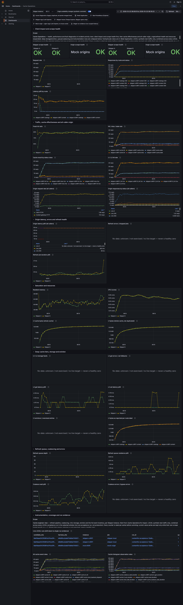
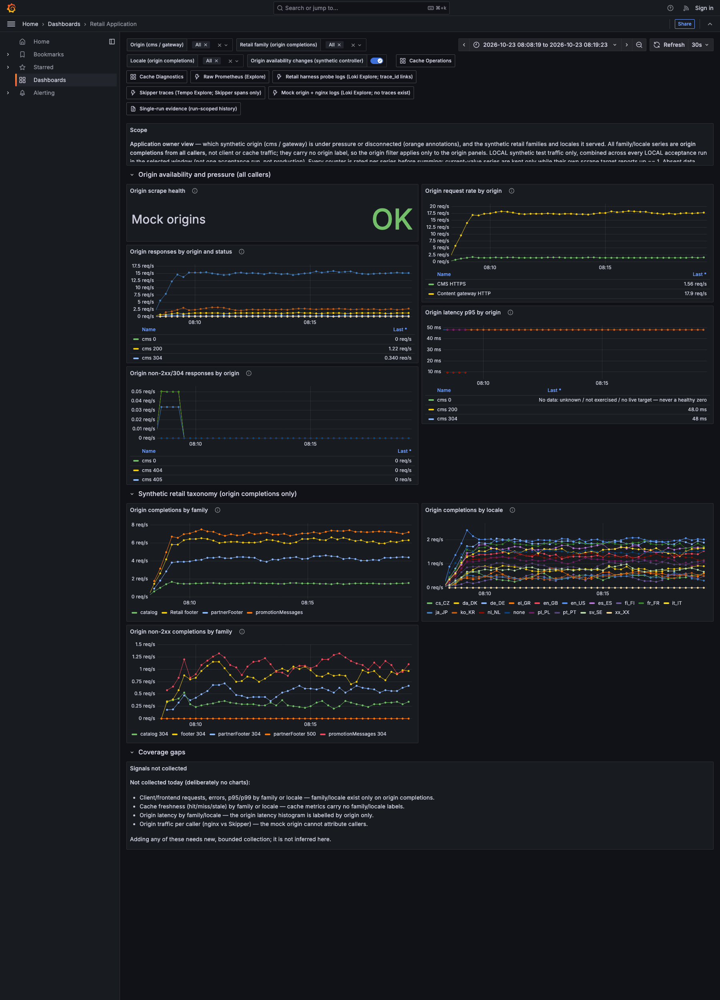
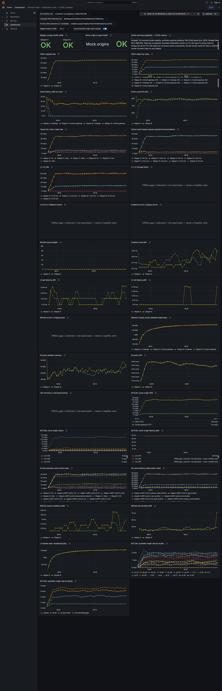

# Completed 60,000-request exercise: visual report

Synthetic local testing related to [PR #4365](https://github.com/zalando/skipper/pull/4365)
checks cache behavior, client responses, and observability. This report covers
the completed 60,000-request exercise in the tested local setup, **not production
capacity** or the PR's current HEAD. Exercise date: **23 October 2026**.

## What happened

| Exercise | Outcome | What we observed |
|---|---|---|
| 60,000 requests | **PASS** | All completed; zero client errors or admission drops. Actual rate: **90.65 requests/s** over **661.92 seconds**. |

The requested rate was best-effort, with no catch-up bursts. This exercise
does not establish a maximum supported rate.

## Cache Operations

Shows cache hits, misses, stale responses, refresh activity, and operational
signals. Use it to understand how the cache behaved alongside traffic—not to
infer production capacity. This is a **combined local history view**, not a
fully run-attributed chart.

## Retail Application

Shows the synthetic origins' availability, request rates, response statuses,
latency, and fictional content families/locales. Origin traffic includes
background refreshes; it is not the same as client traffic. This is also a
**combined local history view**.

## Selected run

Shows the selected successful 60,000-request exercise, bringing client traffic,
cache outcomes, and actual origin activity together. A rendered screenshot
helps explain the results; it does **not replace numerical correctness,
delivery, resource, or coverage checks**.

All three screenshots above come from the successful exercise's end-of-run
captures. Missing or unexercised signals must not be read as healthy zeroes.

Methodology, revision history, and full results: [DEEPDIVE.md](DEEPDIVE.md).
