# Run report: 20261025-201019-smoke

- **Scenario:** smoke
- **Started:** 2026-10-25T20:10:19+0100
- **Ended:** 2026-10-25T20:12:20+0100
- **Duration:** 2m 00s
- **Max VUs:** 60
- **cache-e2e commit:** 62170d5
- **Skipper SHA:** 8a80d62e-uncommitted

## Summary

| Requests | Failures | Failure % | Avg (ms) | p50 (ms) | p95 (ms) | p99 (ms) | RPS (avg) |
|---|---|---|---|---|---|---|---|
| 6270 | 0 | 0.00% | 7.8 | 6.0 | 22.0 | 33.0 | 52.03 |

## Endpoints

| Method | Endpoint | Requests | Failures | Failure % | Avg (ms) | p50 (ms) | p95 (ms) | p99 (ms) | RPS (avg) |
|---|---|---|---|---|---|---|---|---|---|
| GET | hard/contentful_footers_direct | 1077 | 0 | 0.00% | 4.8 | 3.0 | 15.0 | 23.0 | 8.94 |
| GET | swr/contentful_footers_direct | 1043 | 0 | 0.00% | 4.9 | 3.0 | 15.0 | 24.0 | 8.65 |
| GET | hard/static_assets | 542 | 0 | 0.00% | 4.7 | 3.0 | 13.0 | 23.0 | 4.50 |
| GET | hard/shop_products | 490 | 0 | 0.00% | 12.5 | 10.0 | 29.0 | 37.0 | 4.07 |
| GET | swr/shop_products | 466 | 0 | 0.00% | 13.3 | 11.0 | 29.0 | 43.0 | 3.87 |
| GET | swr/static_assets | 453 | 0 | 0.00% | 4.8 | 3.0 | 13.0 | 21.0 | 3.76 |
| GET | hard/contentful_spaces | 274 | 0 | 0.00% | 4.7 | 2.0 | 14.0 | 27.0 | 2.27 |
| GET | swr/contentful_spaces | 232 | 0 | 0.00% | 4.8 | 3.0 | 14.0 | 22.0 | 1.93 |
| GET | hard/shop_navigation | 190 | 0 | 0.00% | 8.3 | 7.0 | 21.0 | 25.0 | 1.58 |
| GET | hard/contentful_vouchers | 166 | 0 | 0.00% | 9.3 | 8.0 | 26.0 | 35.0 | 1.38 |

Top 10 of 30 endpoints by request count.

## Failures

None recorded.

## Exceptions

None recorded.

## Grafana

- [Cache Operations](http://127.0.0.1:55853/d/cache-performance-local?orgId=1&from=1792955419693&to=1792955540691)
- [Retail Application](http://127.0.0.1:55853/d/retail-application-local?orgId=1&from=1792955419693&to=1792955540691)

Time range: `from=1792955419693` to `to=1792955540691` (epoch ms). The base URL is the one in `.runtime/urls.txt` at report time; ports change between runs.

## Panel screenshots

### cache-performance-cache-hit-ratio

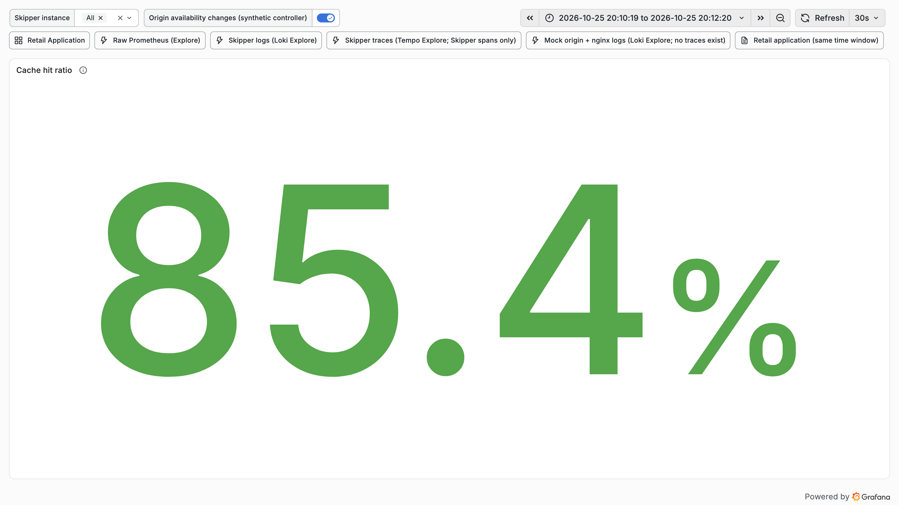

### cache-performance-hit-miss-stale-rate

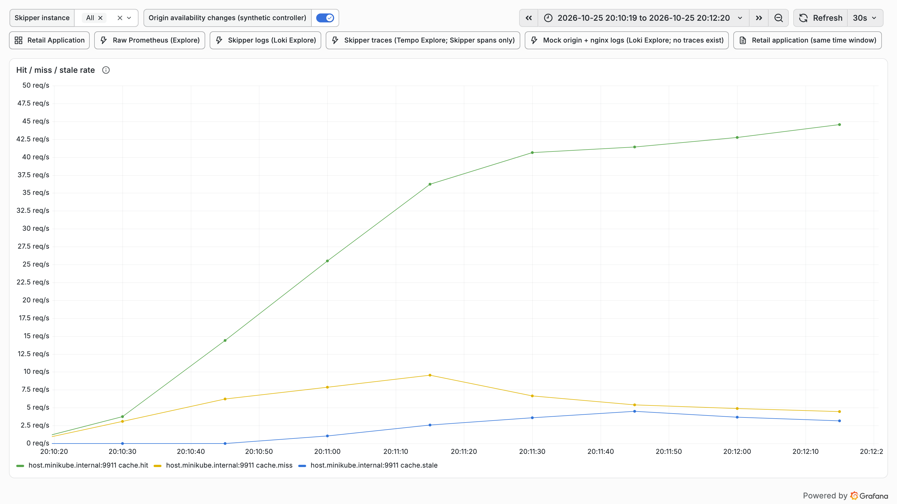

### cache-performance-l1-l2-hit-rate

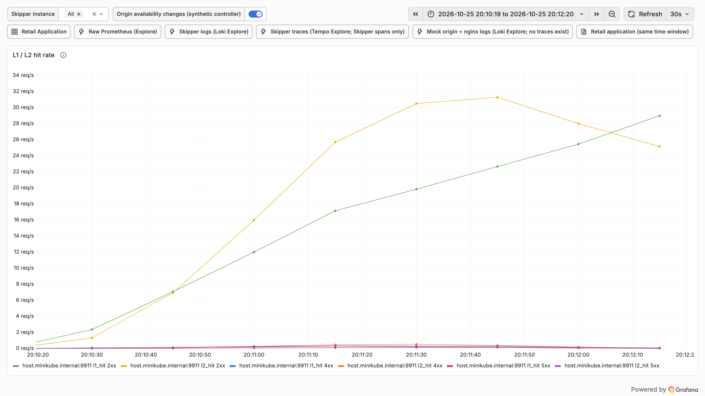

### cache-performance-origin-latency-p95

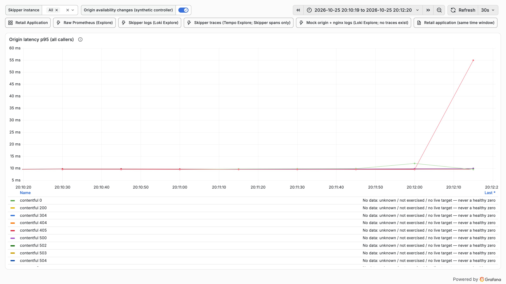

### cache-performance-origin-offload

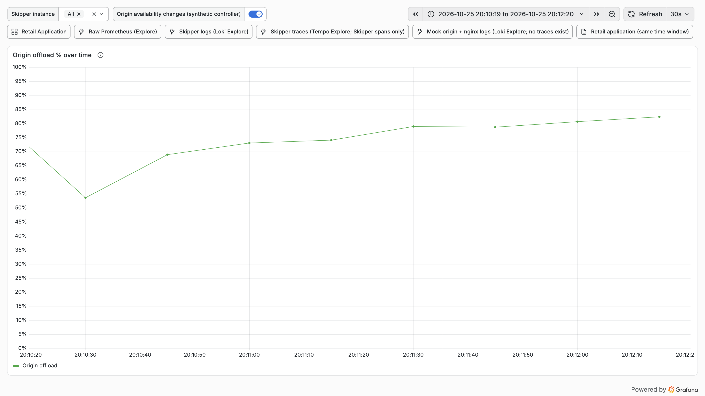

### cache-performance-origin-responses-status

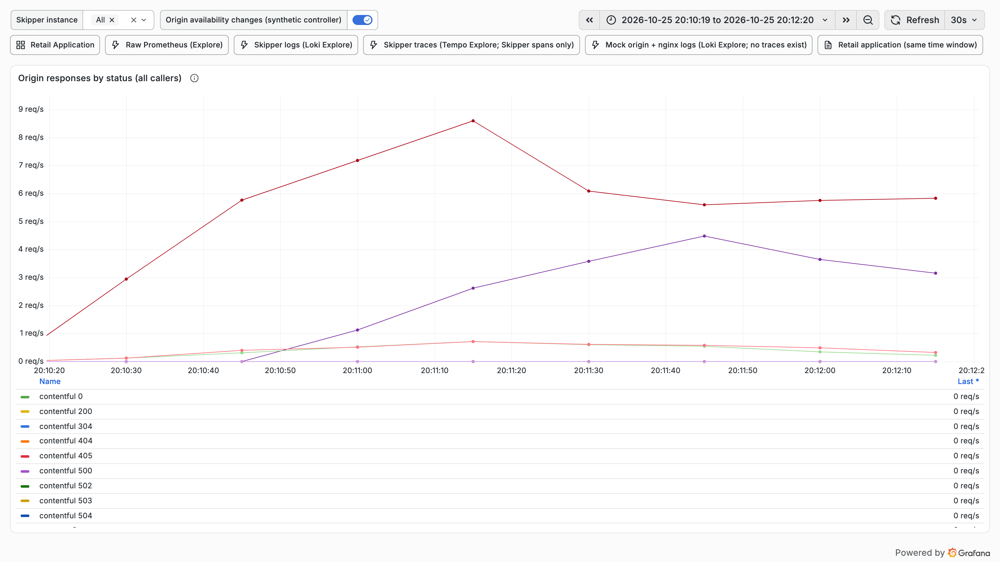

### cache-performance-refresh-errors

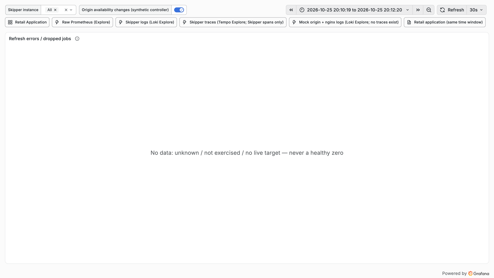

### cache-performance-request-rate

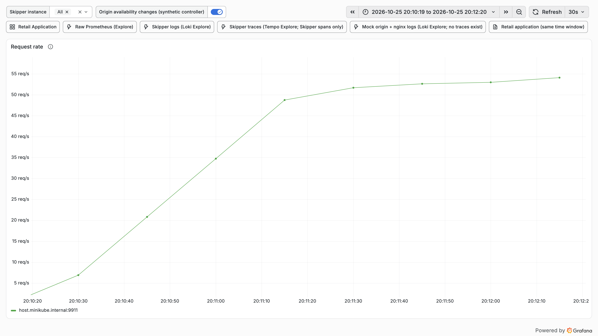

### cache-performance-time-to-first-hit

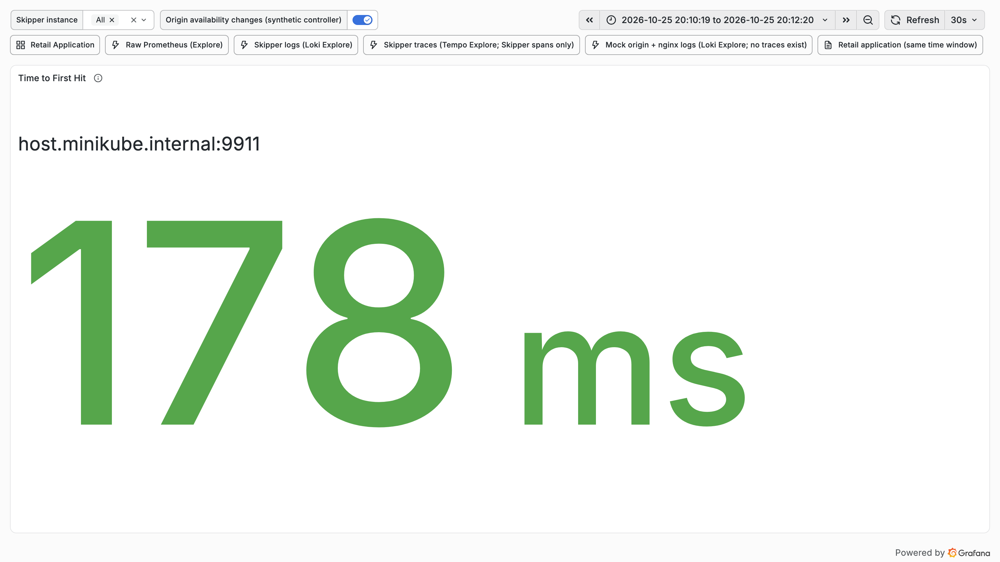

### retail-application-retail-non-2xx

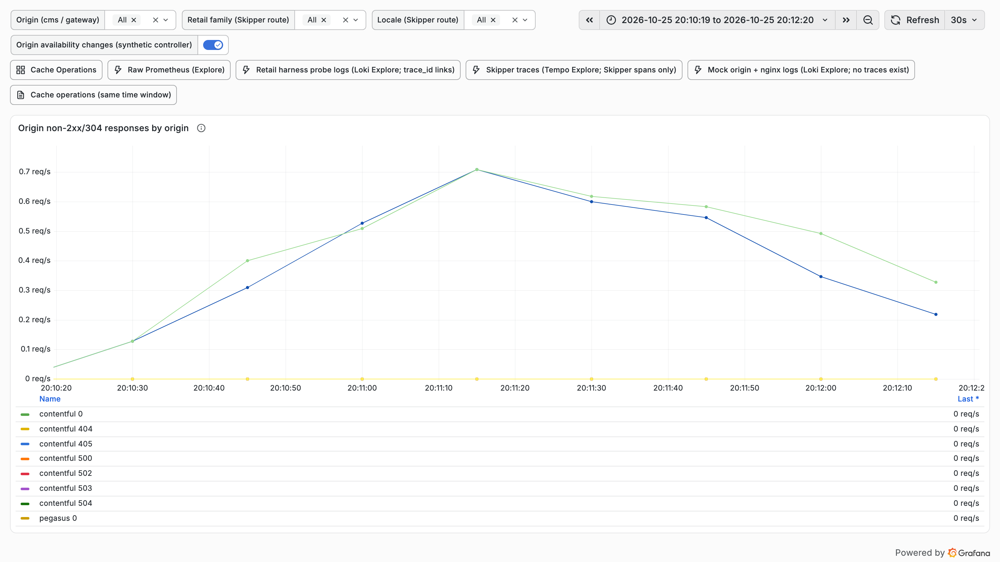

### retail-application-retail-origin-responses

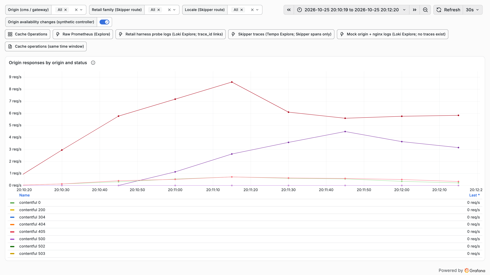
