# Run report: 20261025-201220-origin-stale

- **Scenario:** origin-stale
- **Started:** 2026-10-25T20:12:20+0100
- **Ended:** 2026-10-25T20:17:21+0100
- **Duration:** 5m 00s
- **Max VUs:** 300
- **cache-e2e commit:** 62170d5
- **Skipper SHA:** 8a80d62e-uncommitted

## Summary

| Requests | Failures | Failure % | Avg (ms) | p50 (ms) | p95 (ms) | p99 (ms) | RPS (avg) |
|---|---|---|---|---|---|---|---|
| 44288 | 11828 | 26.71% | 4.5 | 2.0 | 14.0 | 25.0 | 147.56 |

## Endpoints

| Method | Endpoint | Requests | Failures | Failure % | Avg (ms) | p50 (ms) | p95 (ms) | p99 (ms) | RPS (avg) |
|---|---|---|---|---|---|---|---|---|---|
| GET | hard/contentful_footers_direct | 10450 | 3535 | 33.83% | 2.9 | 2.0 | 9.0 | 17.0 | 34.82 |
| GET | hard/contentful_spaces | 7441 | 3942 | 52.98% | 2.0 | 1.0 | 5.0 | 10.0 | 24.79 |
| GET | hard/shop_products | 4550 | 320 | 7.03% | 6.5 | 5.0 | 18.0 | 31.0 | 15.16 |
| GET | hard/contentful_vouchers | 3110 | 472 | 15.18% | 3.8 | 2.0 | 12.0 | 22.0 | 10.36 |
| GET | hard/contentful_footers_external | 2725 | 369 | 13.54% | 4.4 | 3.0 | 13.0 | 22.0 | 9.08 |
| GET | hard/shop_search | 2238 | 517 | 23.10% | 5.9 | 4.0 | 17.0 | 29.0 | 7.46 |
| GET | hard/static_assets | 1967 | 78 | 3.97% | 3.4 | 2.0 | 10.0 | 18.0 | 6.55 |
| GET | swr/contentful_footers_direct | 1663 | 504 | 30.31% | 4.4 | 3.0 | 13.0 | 20.0 | 5.54 |
| GET | hard/shop_images | 1352 | 149 | 11.02% | 3.2 | 2.0 | 10.0 | 16.0 | 4.50 |
| GET | swr/contentful_spaces | 1164 | 616 | 52.92% | 2.8 | 2.0 | 7.0 | 16.0 | 3.88 |

Top 10 of 30 endpoints by request count.

## Failures

| Method | Endpoint | Error | Occurrences |
|---|---|---|---|
| GET | swr/shop_products | CatchResponseError('status') | 54 |
| GET | hard/shop_products | CatchResponseError('status') | 320 |
| GET | swr/shop_search | CatchResponseError('status') | 53 |
| GET | swr/site_meta | CatchResponseError('status') | 18 |
| GET | hard/contentful_vouchers | CatchResponseError('status') | 472 |
| GET | swr/shop_categories | CatchResponseError('status') | 36 |
| GET | swr/shop_images | CatchResponseError('status') | 21 |
| POST | swr/shop_mutations | CatchResponseError('status') | 12 |
| GET | hard/shop_search | CatchResponseError('status') | 517 |
| HEAD | hard/static_head | CatchResponseError('status') | 36 |
| GET | hard/shop_categories | CatchResponseError('status') | 195 |
| GET | hard/shop_promotions | CatchResponseError('status') | 361 |
| GET | hard/contentful_footers_direct | CatchResponseError('status') | 3535 |
| GET | hard/site_meta | CatchResponseError('status') | 67 |
| GET | hard/contentful_spaces | CatchResponseError('status') | 3942 |
| GET | swr/static_assets | CatchResponseError('status') | 19 |
| GET | hard/contentful_footers_external | CatchResponseError('status') | 369 |
| GET | swr/shop_promotions | CatchResponseError('status') | 57 |
| GET | hard/static_assets | CatchResponseError('status') | 78 |
| GET | swr/contentful_vouchers | CatchResponseError('status') | 81 |

8 more rows not shown.

## Exceptions

None recorded.

## Grafana

- [Cache Operations](http://127.0.0.1:55853/d/cache-performance-local?orgId=1&from=1792955540816&to=1792955841604)
- [Retail Application](http://127.0.0.1:55853/d/retail-application-local?orgId=1&from=1792955540816&to=1792955841604)

Time range: `from=1792955540816` to `to=1792955841604` (epoch ms). The base URL is the one in `.runtime/urls.txt` at report time; ports change between runs.

## Panel screenshots

### cache-performance-cache-hit-ratio

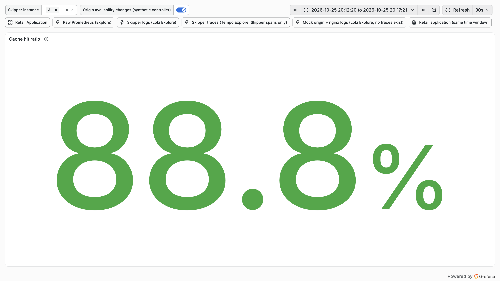

### cache-performance-hit-miss-stale-rate

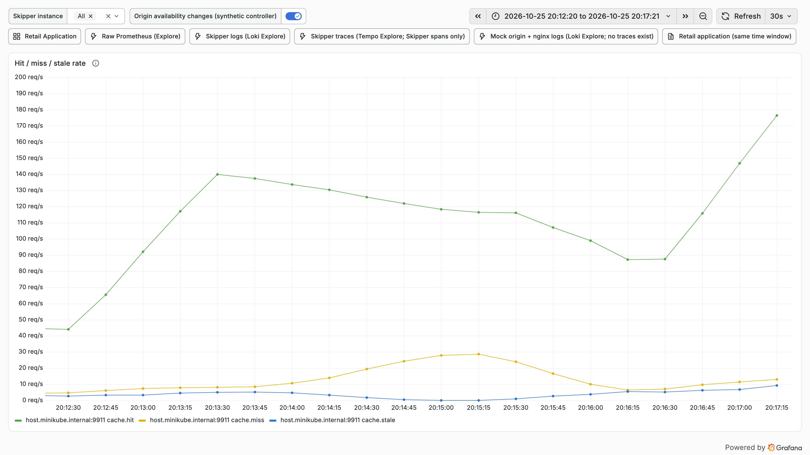

### cache-performance-l1-l2-hit-rate

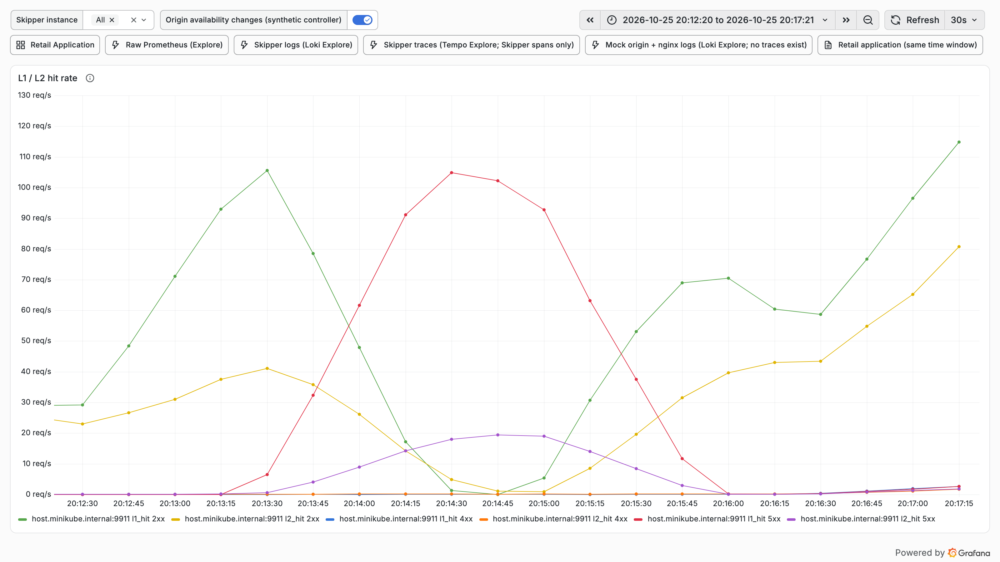

### cache-performance-origin-latency-p95

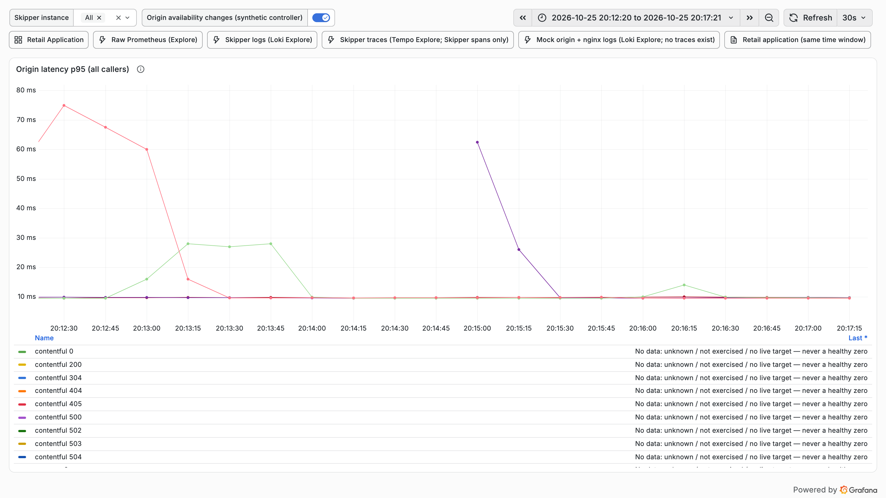

### cache-performance-origin-offload

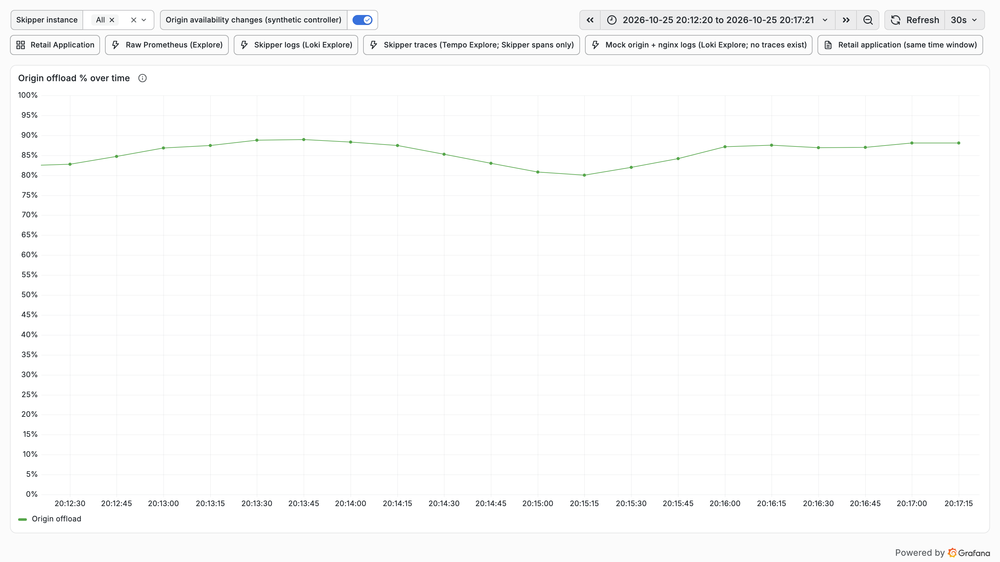

### cache-performance-origin-responses-status

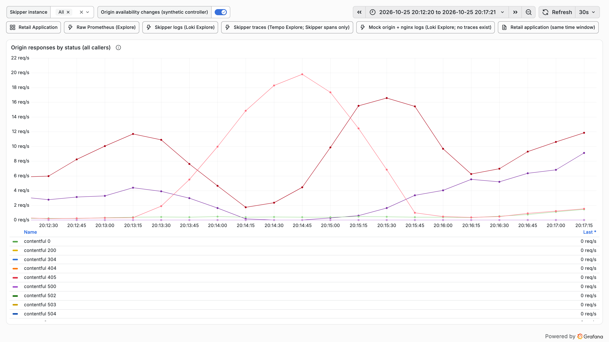

### cache-performance-refresh-errors

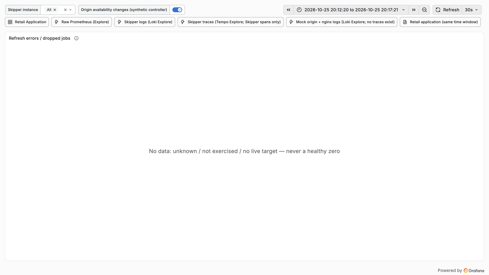

### cache-performance-request-rate

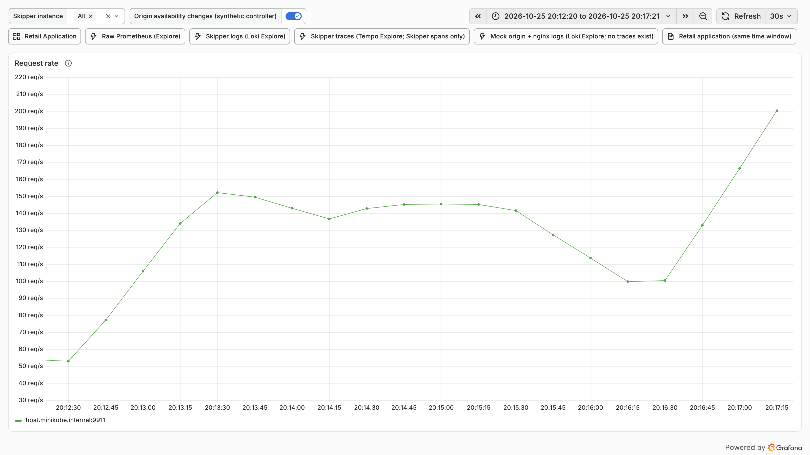

### cache-performance-time-to-first-hit

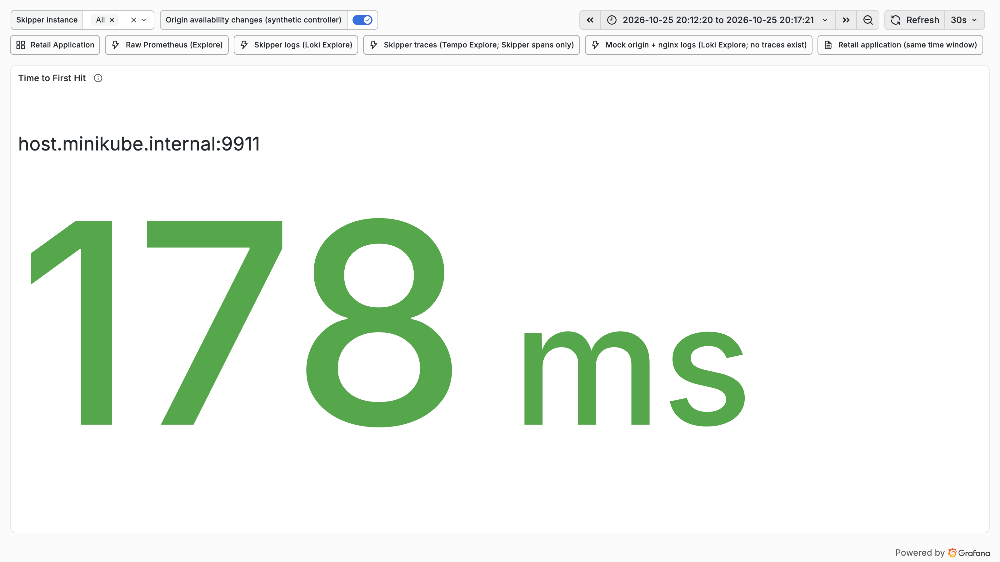

### retail-application-retail-non-2xx

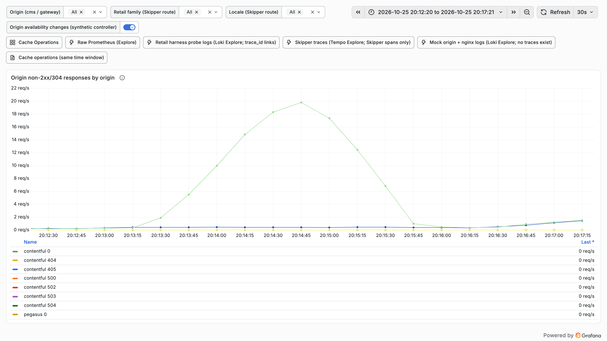

### retail-application-retail-origin-responses

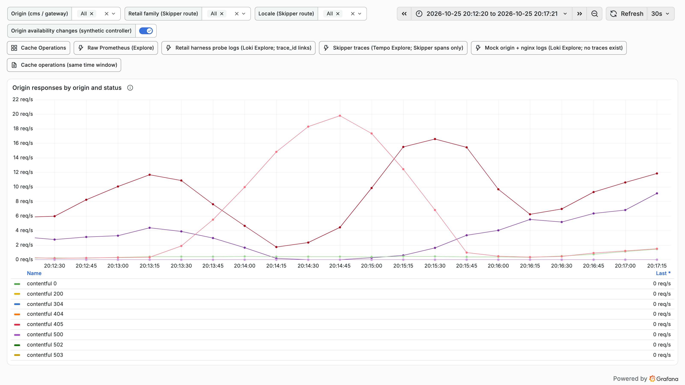

## Fault timeline

| Time | Action | Scheduled offset | Detail |
|---|---|---|---|
| 2026-10-25T20:13:20+0100 | origin-503 | 60s | origin default case status 503 |
| 2026-10-25T20:14:50+0100 | origin-200 | 150s | origin default case status 200 |
| 2026-10-25T20:17:21+0100 | restore |  | origin: origin default case status 200; valkey: valkey up |
