# Run report: 20261025-201721-valkey-kill

- **Scenario:** valkey-kill
- **Started:** 2026-10-25T20:17:21+0100
- **Ended:** 2026-10-25T20:22:22+0100
- **Duration:** 5m 00s
- **Max VUs:** 300
- **cache-e2e commit:** 62170d5
- **Skipper SHA:** 8a80d62e-uncommitted

## Summary

| Requests | Failures | Failure % | Avg (ms) | p50 (ms) | p95 (ms) | p99 (ms) | RPS (avg) |
|---|---|---|---|---|---|---|---|
| 47653 | 0 | 0.00% | 3.8 | 2.0 | 12.0 | 22.0 | 158.78 |

## Endpoints

| Method | Endpoint | Requests | Failures | Failure % | Avg (ms) | p50 (ms) | p95 (ms) | p99 (ms) | RPS (avg) |
|---|---|---|---|---|---|---|---|---|---|
| GET | swr/contentful_vouchers | 6623 | 0 | 0.00% | 2.6 | 2.0 | 8.0 | 14.0 | 22.07 |
| GET | swr/contentful_spaces | 6336 | 0 | 0.00% | 2.1 | 1.0 | 5.0 | 10.0 | 21.11 |
| GET | swr/contentful_footers_external | 5056 | 0 | 0.00% | 3.0 | 2.0 | 9.0 | 17.0 | 16.85 |
| GET | swr/contentful_footers_direct | 5040 | 0 | 0.00% | 3.0 | 2.0 | 9.0 | 16.0 | 16.79 |
| GET | swr/shop_products | 3335 | 0 | 0.00% | 5.7 | 4.0 | 16.0 | 28.0 | 11.11 |
| GET | hard/contentful_vouchers | 2083 | 0 | 0.00% | 3.3 | 2.0 | 9.0 | 17.0 | 6.94 |
| GET | hard/contentful_spaces | 2069 | 0 | 0.00% | 2.2 | 2.0 | 6.0 | 9.0 | 6.89 |
| GET | swr/shop_search | 1899 | 0 | 0.00% | 5.3 | 3.0 | 15.0 | 24.0 | 6.33 |
| GET | swr/shop_categories | 1616 | 0 | 0.00% | 8.0 | 6.0 | 21.0 | 36.0 | 5.38 |
| GET | hard/contentful_footers_external | 1579 | 0 | 0.00% | 3.6 | 2.0 | 11.0 | 21.0 | 5.26 |

Top 10 of 30 endpoints by request count.

## Failures

None recorded.

## Exceptions

None recorded.

## Grafana

- [Cache Operations](http://127.0.0.1:55853/d/cache-performance-local?orgId=1&from=1792955841715&to=1792956142480)
- [Retail Application](http://127.0.0.1:55853/d/retail-application-local?orgId=1&from=1792955841715&to=1792956142480)

Time range: `from=1792955841715` to `to=1792956142480` (epoch ms). The base URL is the one in `.runtime/urls.txt` at report time; ports change between runs.

## Panel screenshots

### cache-performance-cache-hit-ratio

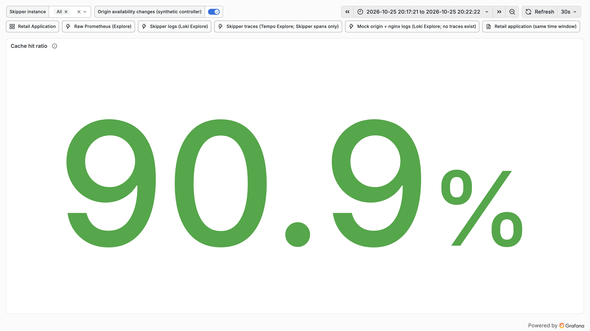

### cache-performance-hit-miss-stale-rate

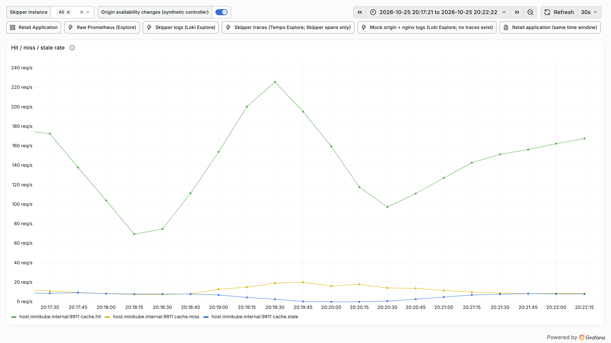

### cache-performance-l1-l2-hit-rate

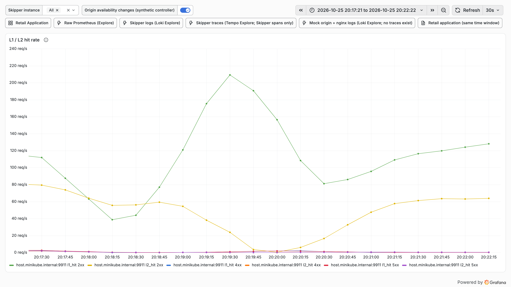

### cache-performance-origin-latency-p95

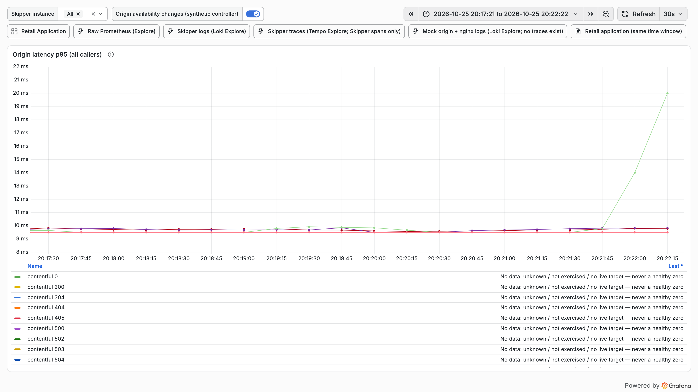

### cache-performance-origin-offload

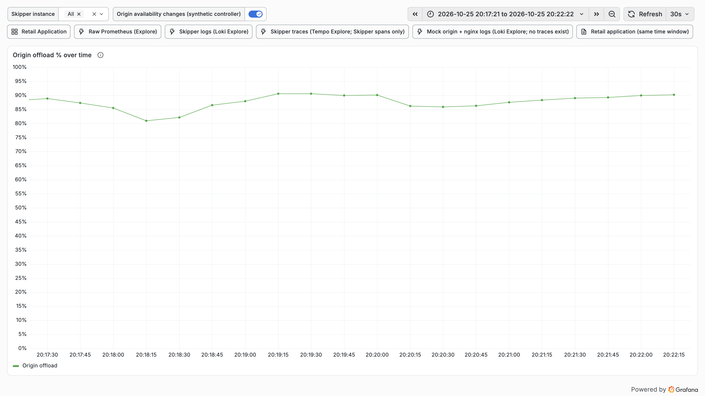

### cache-performance-origin-responses-status

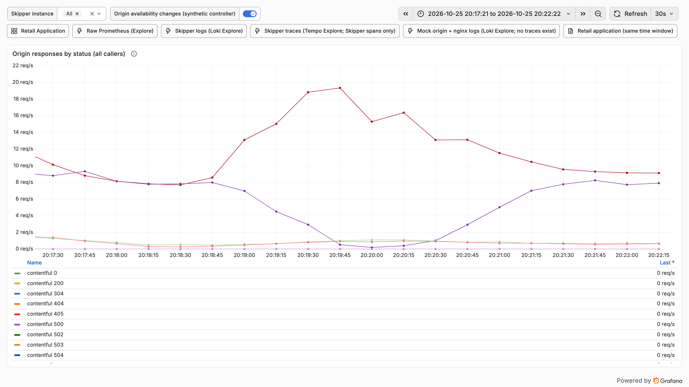

### cache-performance-refresh-errors

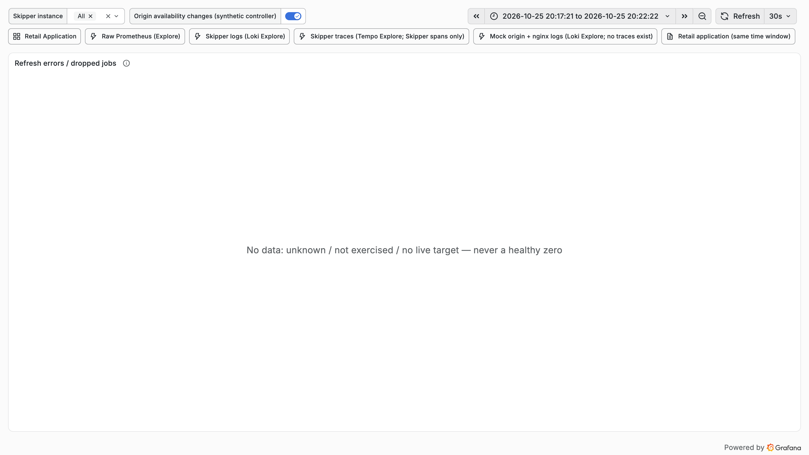

### cache-performance-request-rate

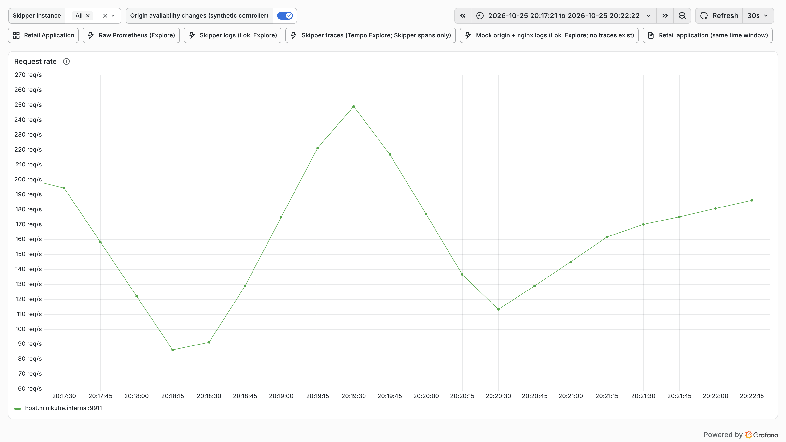

### cache-performance-time-to-first-hit

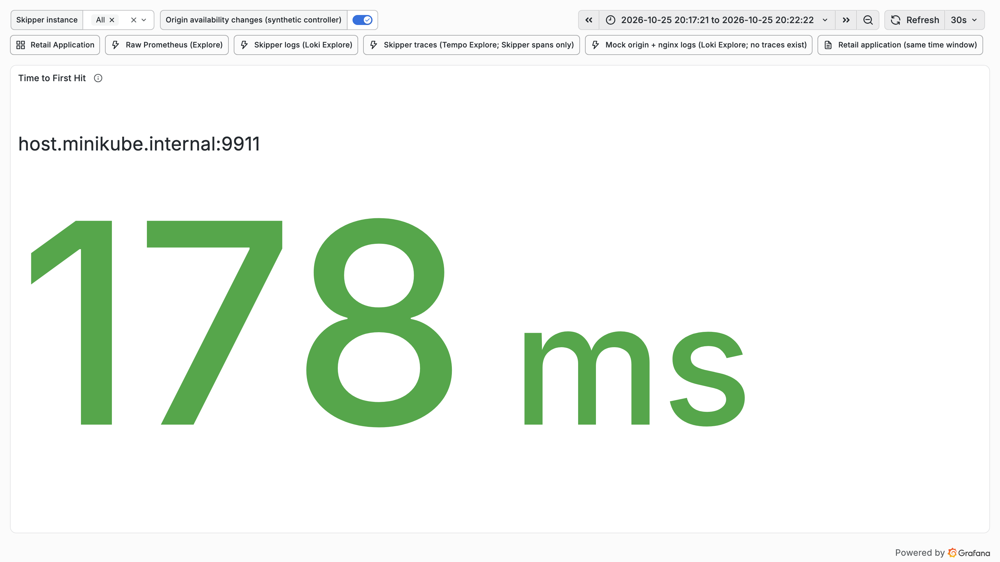

### retail-application-retail-non-2xx

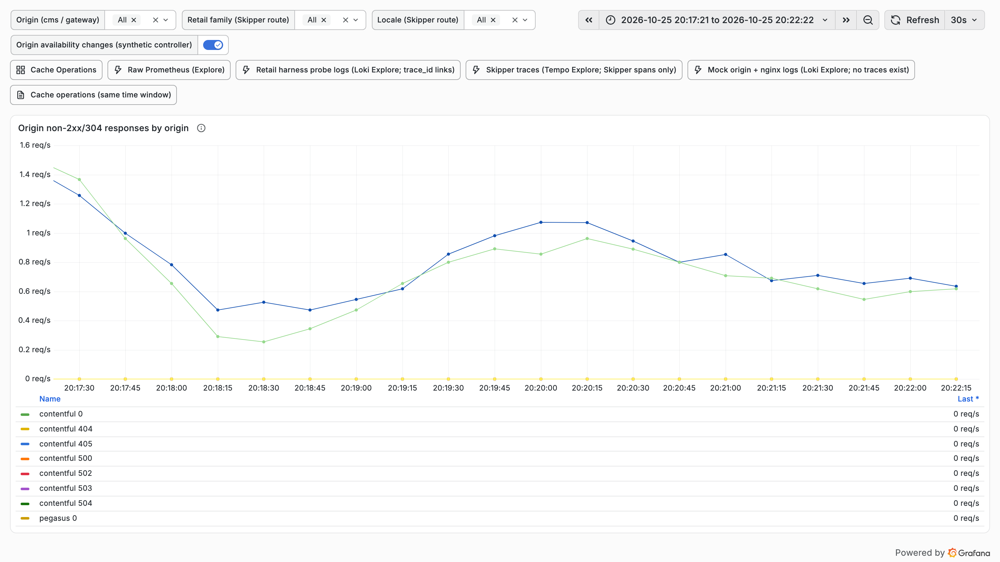

### retail-application-retail-origin-responses

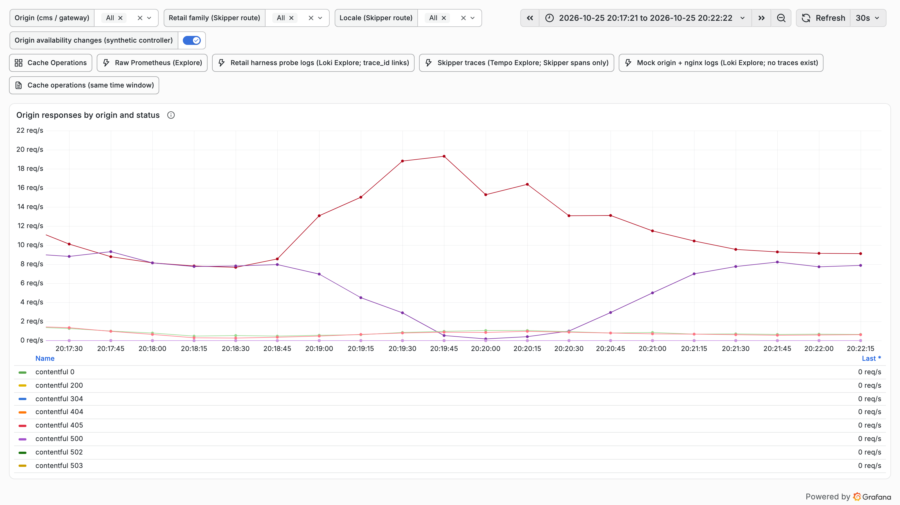

## Fault timeline

| Time | Action | Scheduled offset | Detail |
|---|---|---|---|
| 2026-10-25T20:18:51+0100 | valkey-down | 90s | valkey down |
| 2026-10-25T20:19:51+0100 | valkey-up | 150s | valkey up |
| 2026-10-25T20:22:22+0100 | restore |  | origin: origin default case status 200; valkey: valkey up |
