# Run report: 20261025-202222-skipper-kill

- **Scenario:** skipper-kill
- **Started:** 2026-10-25T20:22:22+0100
- **Ended:** 2026-10-25T20:27:23+0100
- **Duration:** 5m 01s
- **Max VUs:** 300
- **cache-e2e commit:** 62170d5
- **Skipper SHA:** 8a80d62e-uncommitted

## Summary

| Requests | Failures | Failure % | Avg (ms) | p50 (ms) | p95 (ms) | p99 (ms) | RPS (avg) |
|---|---|---|---|---|---|---|---|
| 38969 | 397 | 1.02% | 7.6 | 4.0 | 19.0 | 84.0 | 129.70 |

## Endpoints

| Method | Endpoint | Requests | Failures | Failure % | Avg (ms) | p50 (ms) | p95 (ms) | p99 (ms) | RPS (avg) |
|---|---|---|---|---|---|---|---|---|---|
| GET | hard/contentful_footers_direct | 4477 | 44 | 0.98% | 5.0 | 3.0 | 13.0 | 43.0 | 14.90 |
| GET | hard/contentful_spaces | 4129 | 32 | 0.78% | 3.5 | 2.0 | 7.0 | 21.0 | 13.74 |
| GET | hard/contentful_vouchers | 2765 | 21 | 0.76% | 5.1 | 3.0 | 14.0 | 37.0 | 9.20 |
| GET | swr/contentful_footers_direct | 2365 | 24 | 1.01% | 5.8 | 3.0 | 14.0 | 63.0 | 7.87 |
| GET | swr/contentful_spaces | 2090 | 17 | 0.81% | 3.7 | 2.0 | 8.0 | 28.0 | 6.96 |
| GET | hard/shop_products | 1868 | 30 | 1.61% | 11.9 | 8.0 | 29.0 | 110.0 | 6.22 |
| GET | hard/contentful_footers_external | 1780 | 25 | 1.40% | 7.1 | 4.0 | 18.0 | 83.0 | 5.92 |
| GET | hard/shop_personal | 1734 | 26 | 1.50% | 12.8 | 8.0 | 30.0 | 120.0 | 5.77 |
| GET | hard/shop_navigation | 1506 | 37 | 2.46% | 5.8 | 3.0 | 15.0 | 42.0 | 5.01 |
| GET | hard/shop_categories | 1421 | 12 | 0.84% | 16.4 | 7.0 | 57.0 | 190.0 | 4.73 |

Top 10 of 30 endpoints by request count.

## Failures

| Method | Endpoint | Error | Occurrences |
|---|---|---|---|
| GET | swr/shop_products | CatchResponseError('status') | 9 |
| GET | hard/shop_products | CatchResponseError('status') | 30 |
| GET | hard/shop_personal | CatchResponseError('status') | 26 |
| GET | swr/shop_search | CatchResponseError('status') | 9 |
| GET | swr/site_meta | CatchResponseError('status') | 2 |
| GET | hard/contentful_vouchers | CatchResponseError('status') | 21 |
| GET | swr/shop_categories | CatchResponseError('status') | 7 |
| GET | swr/shop_images | CatchResponseError('status') | 3 |
| POST | swr/shop_mutations | CatchResponseError('status') | 1 |
| GET | hard/shop_search | CatchResponseError('status') | 8 |
| HEAD | hard/static_head | CatchResponseError('status') | 6 |
| GET | hard/shop_categories | CatchResponseError('status') | 12 |
| GET | hard/shop_promotions | CatchResponseError('status') | 4 |
| GET | hard/contentful_footers_direct | CatchResponseError('status') | 44 |
| GET | hard/site_meta | CatchResponseError('status') | 3 |
| GET | hard/contentful_spaces | CatchResponseError('status') | 32 |
| GET | swr/static_assets | CatchResponseError('status') | 8 |
| GET | hard/contentful_footers_external | CatchResponseError('status') | 25 |
| GET | swr/shop_promotions | CatchResponseError('status') | 1 |
| GET | hard/static_assets | CatchResponseError('status') | 8 |

10 more rows not shown.

## Exceptions

None recorded.

## Grafana

- [Cache Operations](http://127.0.0.1:55853/d/cache-performance-local?orgId=1&from=1792956142593&to=1792956443740)
- [Retail Application](http://127.0.0.1:55853/d/retail-application-local?orgId=1&from=1792956142593&to=1792956443740)

Time range: `from=1792956142593` to `to=1792956443740` (epoch ms). The base URL is the one in `.runtime/urls.txt` at report time; ports change between runs.

## Panel screenshots

### cache-performance-cache-hit-ratio

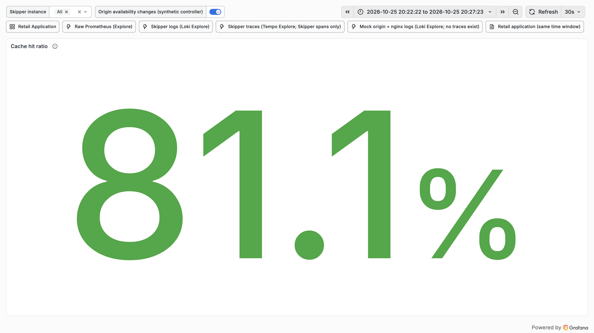

### cache-performance-hit-miss-stale-rate

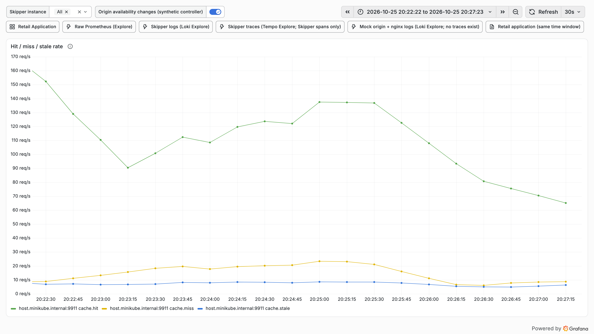

### cache-performance-l1-l2-hit-rate

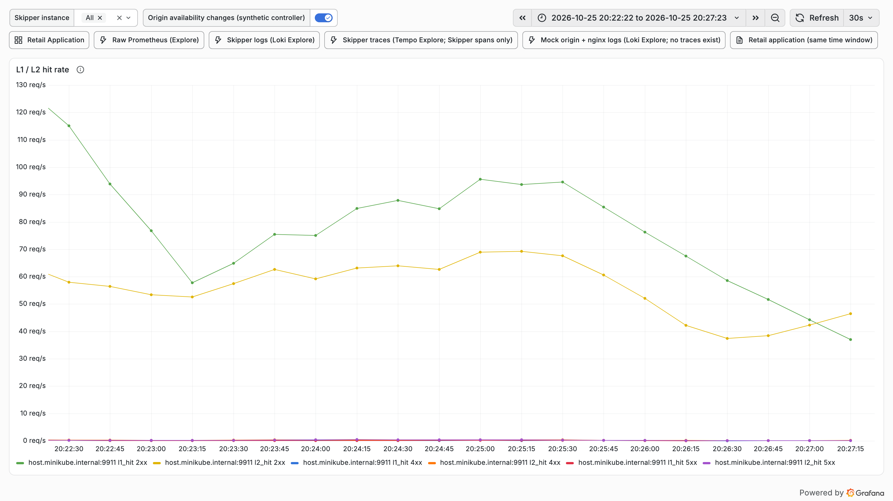

### cache-performance-origin-latency-p95

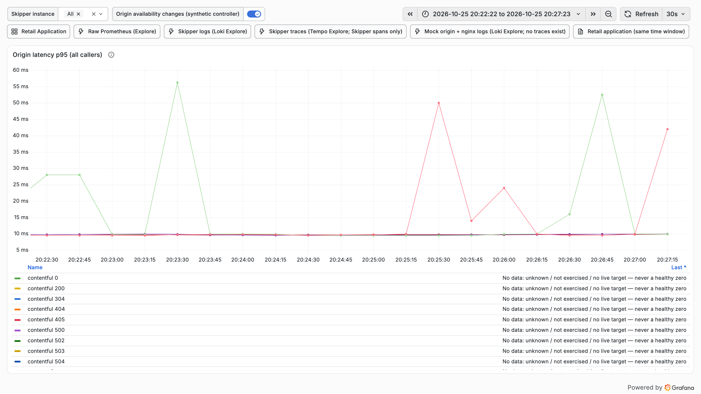

### cache-performance-origin-offload

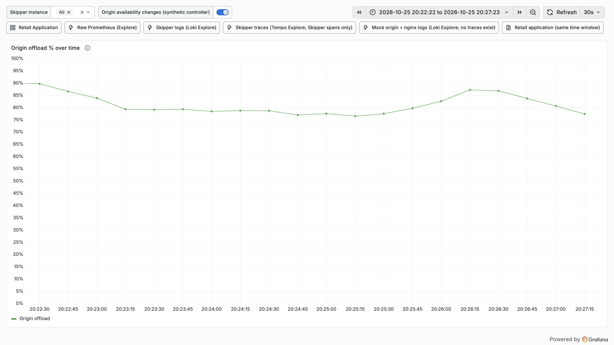

### cache-performance-origin-responses-status

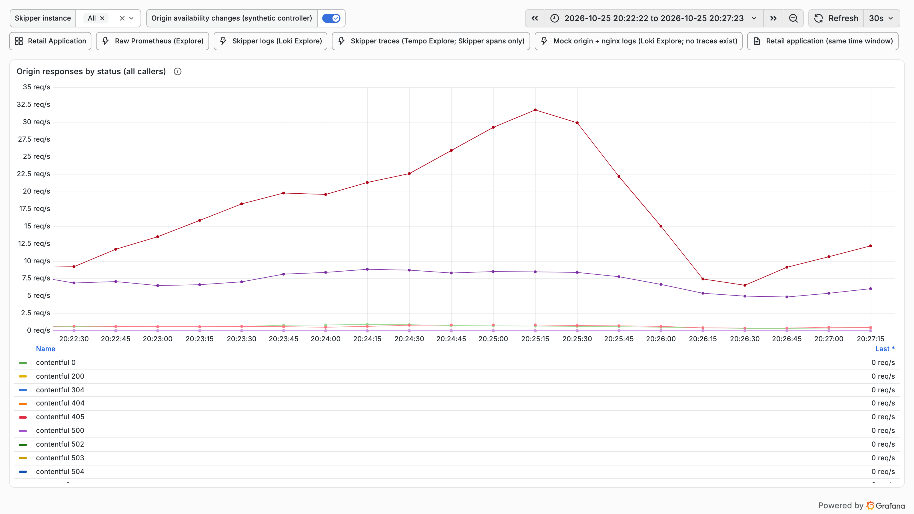

### cache-performance-refresh-errors

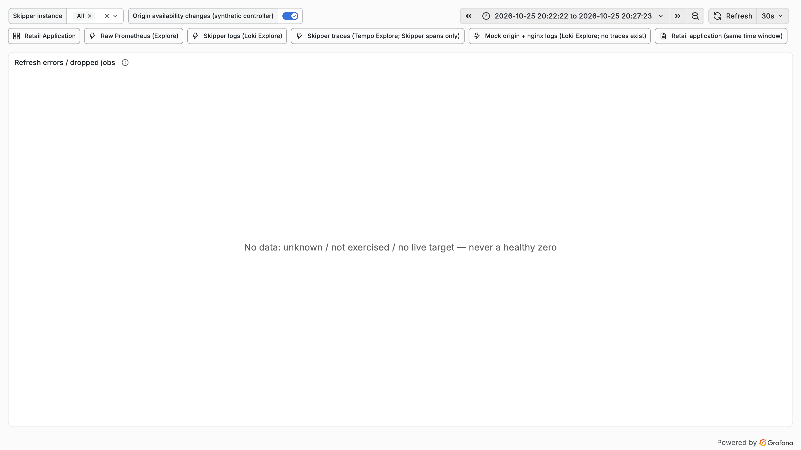

### cache-performance-request-rate

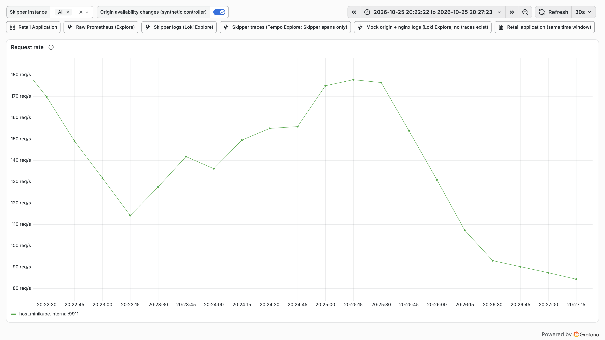

### cache-performance-time-to-first-hit

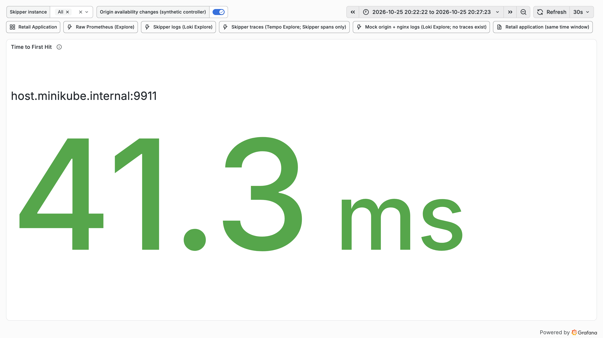

### retail-application-retail-non-2xx

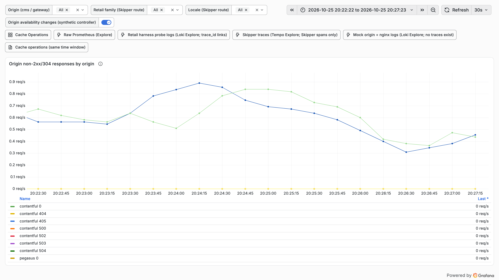

### retail-application-retail-origin-responses

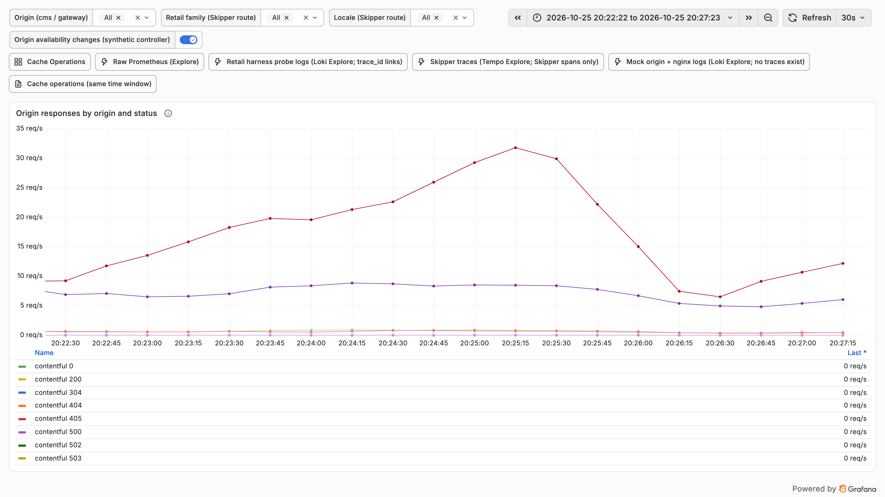

## Fault timeline

| Time | Action | Scheduled offset | Detail |
|---|---|---|---|
| 2026-10-25T20:23:52+0100 | skipper-kill | 90s | killed PID 82072; supervisor restarted as 39074, ready after 2.5s |
| 2026-10-25T20:27:23+0100 | restore |  | origin: origin default case status 200; valkey: valkey up |
