# Run report: 20261025-202723-soak

- **Scenario:** soak
- **Started:** 2026-10-25T20:27:23+0100
- **Ended:** 2026-10-25T20:38:33+0100
- **Duration:** 11m 09s
- **Max VUs:** 300
- **cache-e2e commit:** 62170d5
- **Skipper SHA:** 8a80d62e-uncommitted

## Summary

| Requests | Failures | Failure % | Avg (ms) | p50 (ms) | p95 (ms) | p99 (ms) | RPS (avg) |
|---|---|---|---|---|---|---|---|
| 63036 | 3202 | 5.08% | 615.5 | 4.0 | 5000.0 | 5000.0 | 94.25 |

## Endpoints

| Method | Endpoint | Requests | Failures | Failure % | Avg (ms) | p50 (ms) | p95 (ms) | p99 (ms) | RPS (avg) |
|---|---|---|---|---|---|---|---|---|---|
| GET | hard/contentful_footers_direct | 9837 | 322 | 3.27% | 471.0 | 3.0 | 4000.0 | 5000.0 | 14.71 |
| GET | swr/contentful_footers_direct | 8895 | 348 | 3.91% | 495.7 | 3.0 | 4300.0 | 5000.0 | 13.30 |
| GET | hard/contentful_spaces | 3163 | 55 | 1.74% | 289.3 | 3.0 | 2800.0 | 5000.0 | 4.73 |
| GET | hard/static_assets | 2932 | 58 | 1.98% | 375.3 | 3.0 | 2900.0 | 5000.0 | 4.38 |
| GET | hard/contentful_footers_external | 2809 | 85 | 3.03% | 397.2 | 4.0 | 4100.0 | 5000.0 | 4.20 |
| GET | swr/contentful_spaces | 2808 | 55 | 1.96% | 270.3 | 3.0 | 2500.0 | 5000.0 | 4.20 |
| GET | swr/static_assets | 2754 | 64 | 2.32% | 371.1 | 3.0 | 2900.0 | 5000.0 | 4.12 |
| GET | hard/shop_products | 2635 | 369 | 14.00% | 1285.7 | 10.0 | 5000.0 | 5000.0 | 3.94 |
| GET | swr/contentful_footers_external | 2593 | 93 | 3.59% | 426.4 | 4.0 | 4400.0 | 5000.0 | 3.88 |
| GET | hard/contentful_vouchers | 2441 | 107 | 4.38% | 587.9 | 4.0 | 4800.0 | 5000.0 | 3.65 |

Top 10 of 30 endpoints by request count.

## Failures

| Method | Endpoint | Error | Occurrences |
|---|---|---|---|
| GET | swr/shop_products | CatchResponseError('status') | 342 |
| GET | hard/shop_products | CatchResponseError('status') | 369 |
| GET | hard/shop_personal | CatchResponseError('status') | 3 |
| GET | swr/shop_search | CatchResponseError('status') | 118 |
| GET | swr/site_meta | CatchResponseError('status') | 13 |
| GET | hard/contentful_vouchers | CatchResponseError('status') | 107 |
| GET | swr/shop_categories | CatchResponseError('status') | 166 |
| GET | swr/shop_images | CatchResponseError('status') | 32 |
| POST | swr/shop_mutations | CatchResponseError('status') | 65 |
| GET | hard/shop_search | CatchResponseError('status') | 141 |
| HEAD | hard/static_head | CatchResponseError('status') | 51 |
| GET | hard/shop_categories | CatchResponseError('status') | 194 |
| GET | hard/shop_promotions | CatchResponseError('status') | 70 |
| GET | hard/contentful_footers_direct | CatchResponseError('status') | 322 |
| GET | hard/site_meta | CatchResponseError('status') | 25 |
| GET | hard/contentful_spaces | CatchResponseError('status') | 55 |
| GET | swr/static_assets | CatchResponseError('status') | 64 |
| GET | hard/contentful_footers_external | CatchResponseError('status') | 85 |
| GET | swr/shop_promotions | CatchResponseError('status') | 63 |
| GET | hard/static_assets | CatchResponseError('status') | 58 |

10 more rows not shown.

## Exceptions

None recorded.

## Grafana

- [Cache Operations](http://127.0.0.1:55853/d/cache-performance-local?orgId=1&from=1792956443847&to=1792957113525)
- [Retail Application](http://127.0.0.1:55853/d/retail-application-local?orgId=1&from=1792956443847&to=1792957113525)

Time range: `from=1792956443847` to `to=1792957113525` (epoch ms). The base URL is the one in `.runtime/urls.txt` at report time; ports change between runs.

## Panel screenshots

### cache-performance-cache-hit-ratio

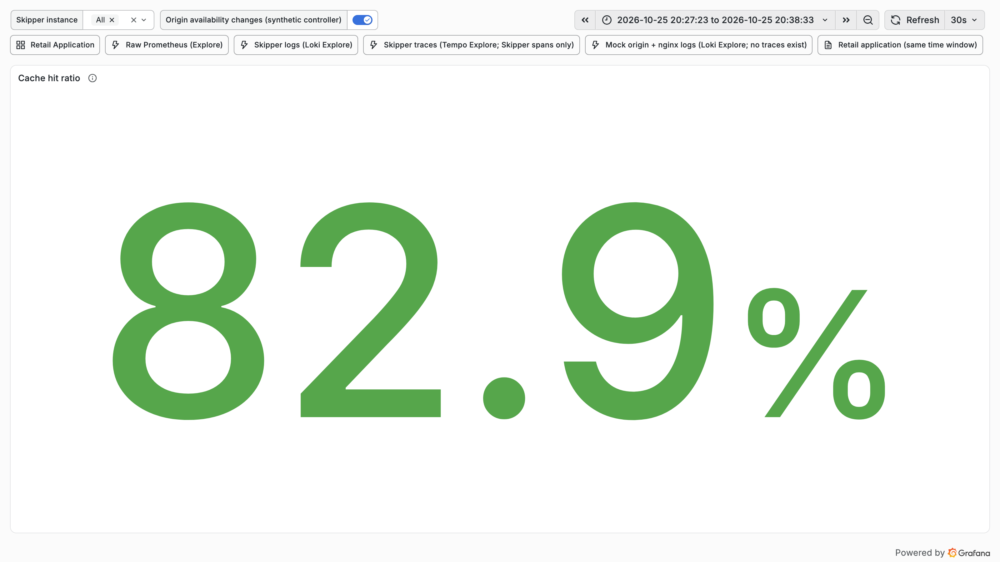

### cache-performance-hit-miss-stale-rate

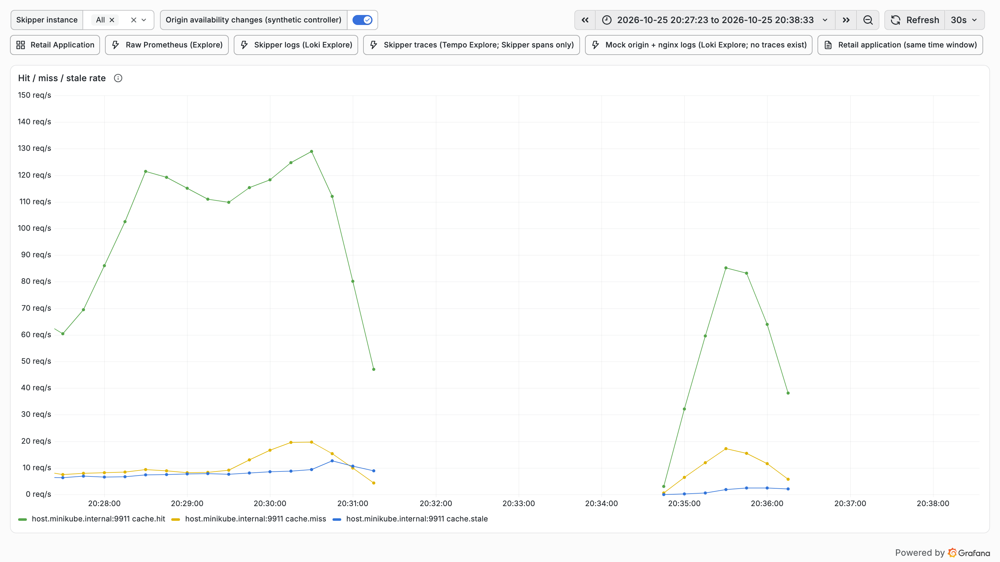

### cache-performance-l1-l2-hit-rate

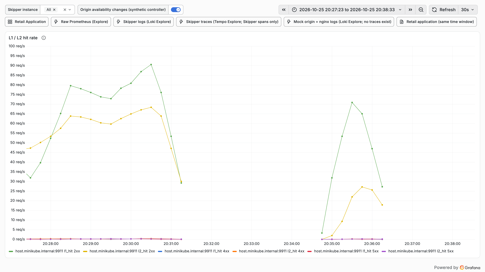

### cache-performance-origin-latency-p95

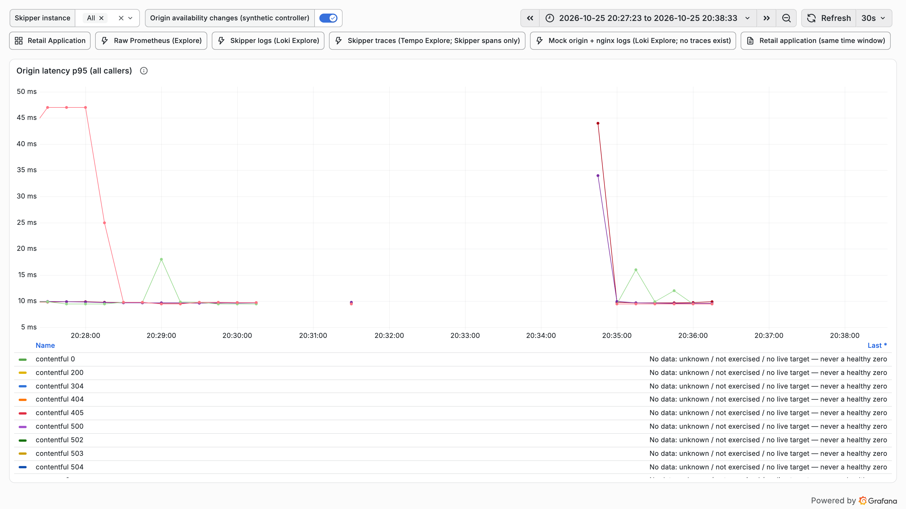

### cache-performance-origin-offload

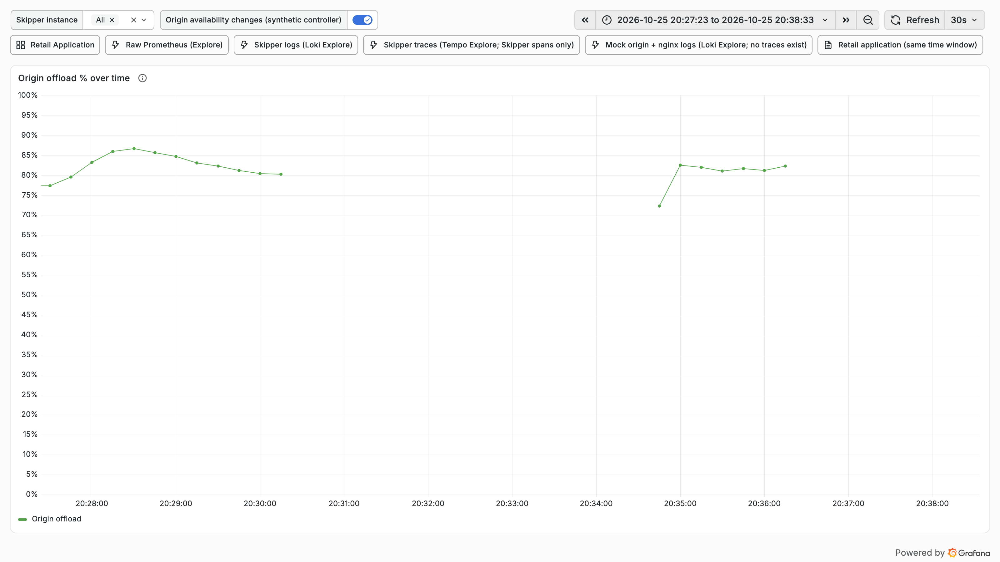

### cache-performance-origin-responses-status

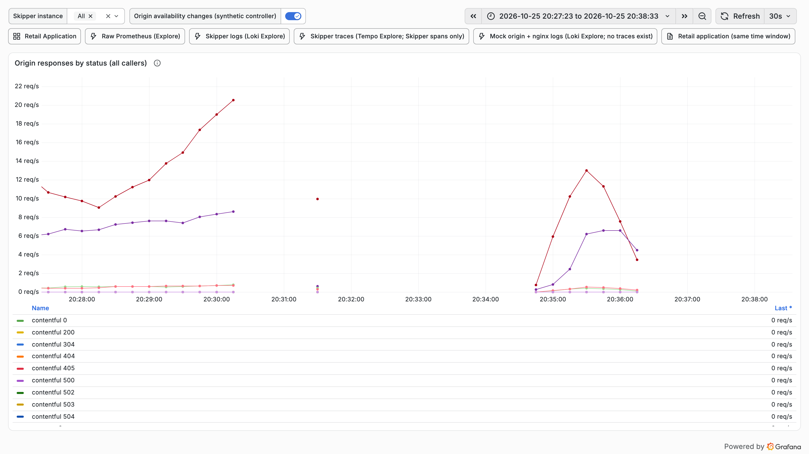

### cache-performance-refresh-errors

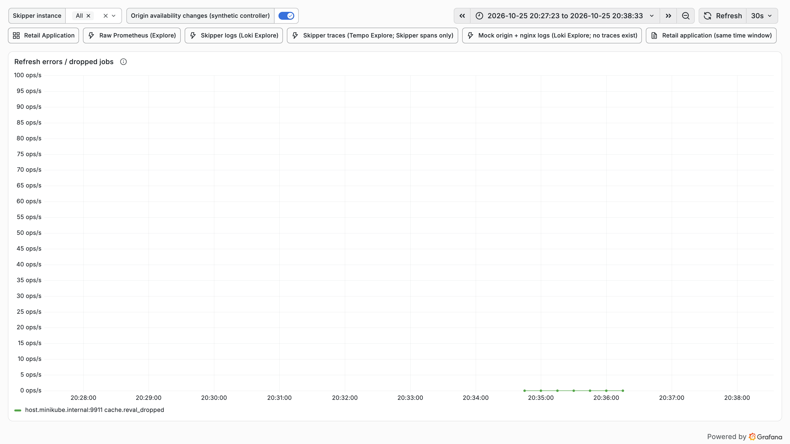

### cache-performance-request-rate

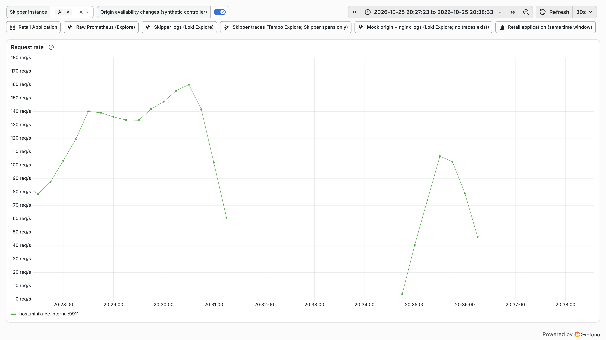

### cache-performance-time-to-first-hit

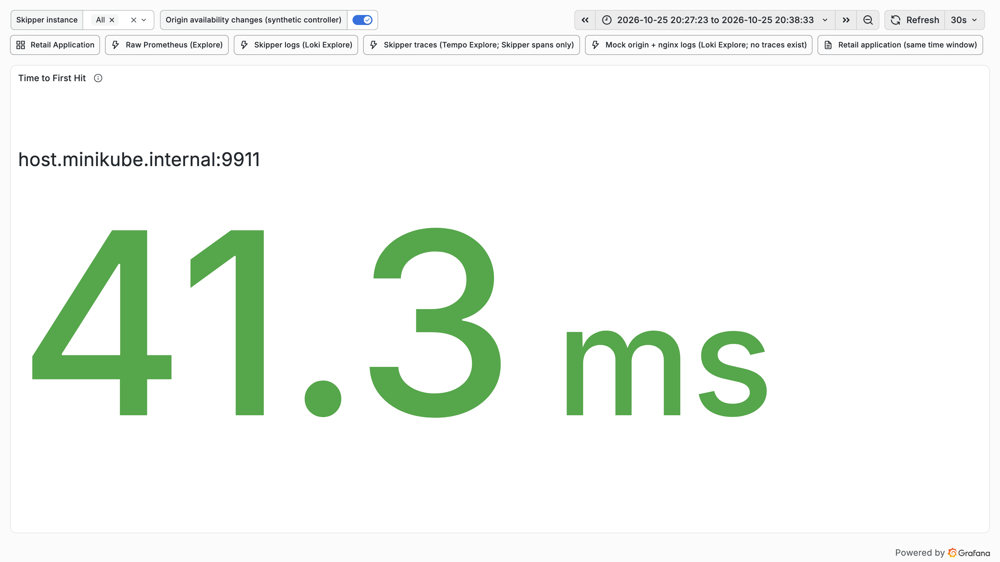

### retail-application-retail-non-2xx

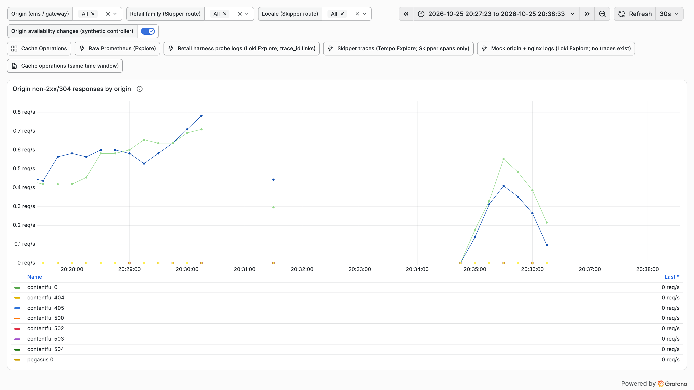

### retail-application-retail-origin-responses

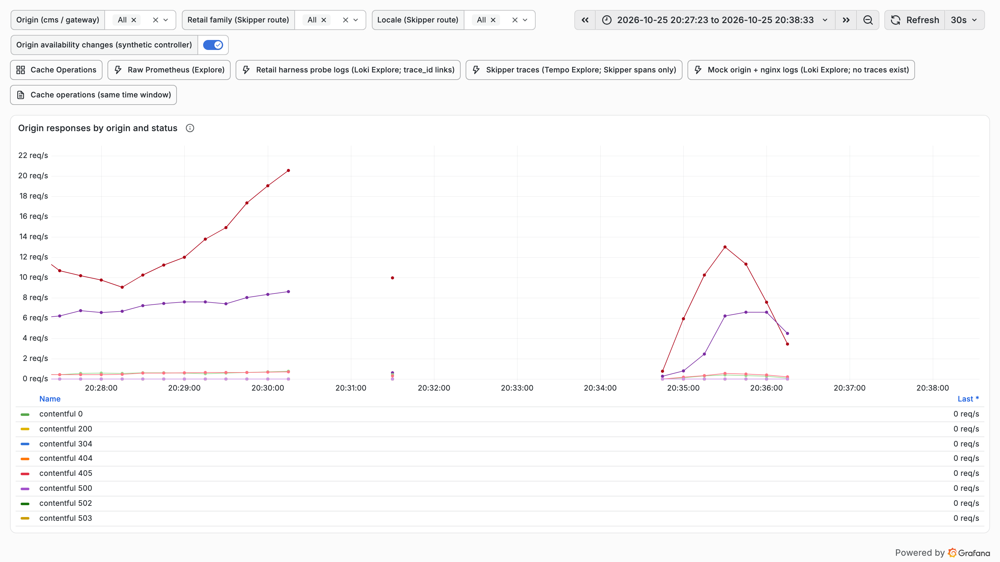
