# Run report: 20261026-145513-smoke

- **Scenario:** smoke
- **Started:** 2026-10-26T14:55:13+0100
- **Ended:** 2026-10-26T14:57:22+0100
- **Duration:** 2m 08s
- **Max VUs:** 60
- **cache-e2e commit:** c00a804
- **Skipper SHA:** bda674b0d1574461a30317b2cd154543baa60f65

## Summary

| Requests | Failures | Failure % | Avg (ms) | p50 (ms) | p95 (ms) | p99 (ms) | RPS (avg) |
|---|---|---|---|---|---|---|---|
| 6306 | 0 | 0.00% | 8.4 | 6.0 | 24.0 | 49.0 | 52.35 |

## Endpoints

| Method | Endpoint | Requests | Failures | Failure % | Avg (ms) | p50 (ms) | p95 (ms) | p99 (ms) | RPS (avg) |
|---|---|---|---|---|---|---|---|---|---|
| GET | swr/static_assets | 619 | 0 | 0.00% | 4.6 | 3.0 | 16.0 | 26.0 | 5.14 |
| GET | hard/static_assets | 615 | 0 | 0.00% | 4.4 | 3.0 | 14.0 | 21.0 | 5.11 |
| GET | hard/contentful_footers_external | 551 | 0 | 0.00% | 6.7 | 4.0 | 21.0 | 37.0 | 4.57 |
| GET | hard/contentful_footers_direct | 505 | 0 | 0.00% | 7.1 | 5.0 | 19.0 | 33.0 | 4.19 |
| GET | swr/contentful_footers_external | 495 | 0 | 0.00% | 6.3 | 4.0 | 19.0 | 29.0 | 4.11 |
| GET | swr/contentful_footers_direct | 489 | 0 | 0.00% | 6.7 | 5.0 | 20.0 | 28.0 | 4.06 |
| GET | hard/contentful_spaces | 342 | 0 | 0.00% | 4.6 | 3.0 | 13.0 | 28.0 | 2.84 |
| GET | swr/contentful_spaces | 334 | 0 | 0.00% | 4.2 | 3.0 | 13.0 | 22.0 | 2.77 |
| GET | hard/contentful_vouchers | 227 | 0 | 0.00% | 8.4 | 6.0 | 24.0 | 42.0 | 1.88 |
| GET | swr/contentful_vouchers | 209 | 0 | 0.00% | 7.9 | 6.0 | 22.0 | 30.0 | 1.74 |

Top 10 of 30 endpoints by request count.

## Failures

None recorded.

## Exceptions

None recorded.

## Grafana

- [Cache Operations](http://127.0.0.1:55853/d/cache-performance-local?orgId=1&from=1793022913911&to=1793023042714)
- [Retail Application](http://127.0.0.1:55853/d/retail-application-local?orgId=1&from=1793022913911&to=1793023042714)

Time range: `from=1793022913911` to `to=1793023042714` (epoch ms). The base URL is the one in `.runtime/urls.txt` at report time; ports change between runs.

## Panel screenshots

### cache-performance-cache-bytes-vs-capacity

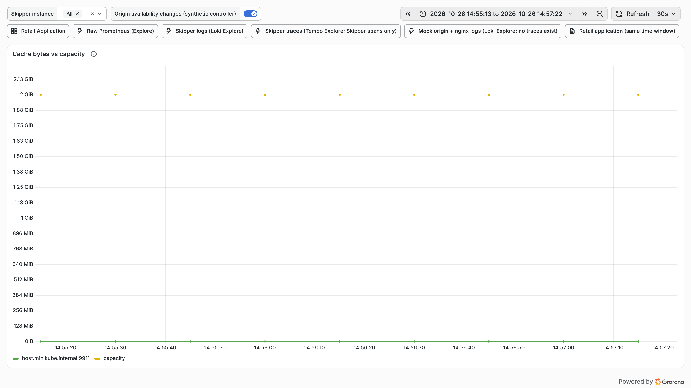

### cache-performance-cache-control-directives

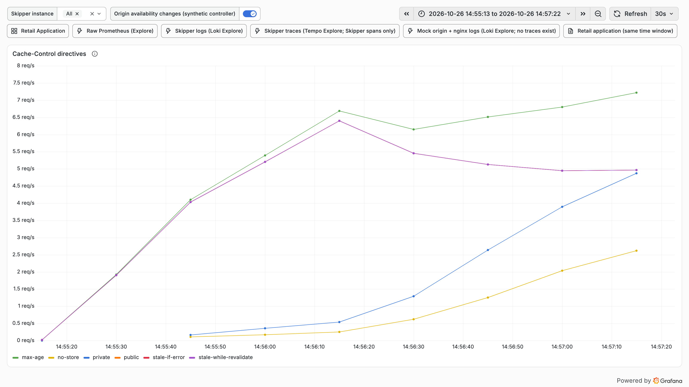

### cache-performance-cache-entries

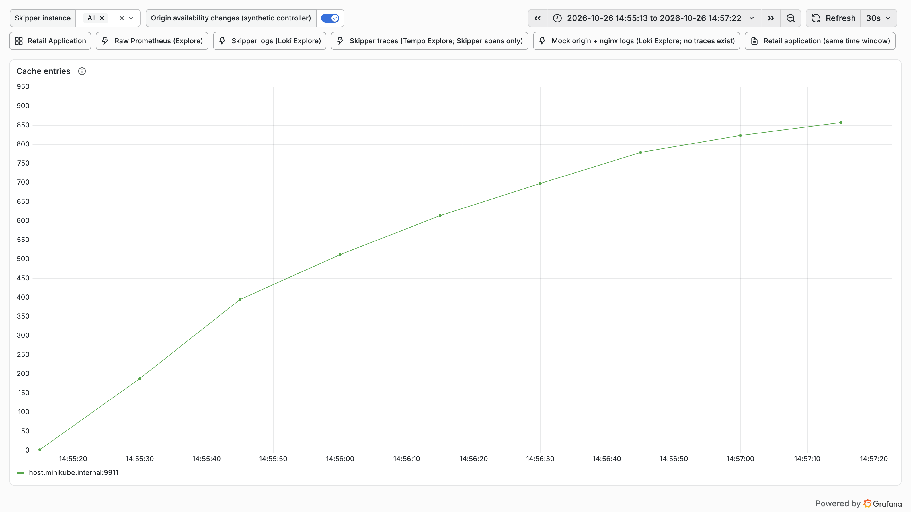

### cache-performance-cache-hit-ratio

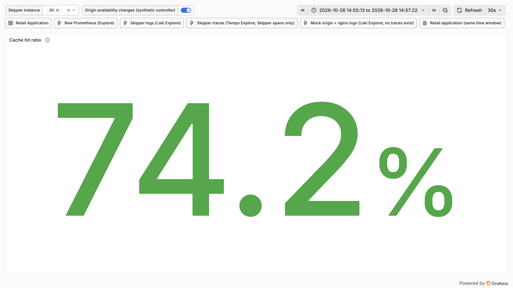

### cache-performance-cache-outcomes-by-family

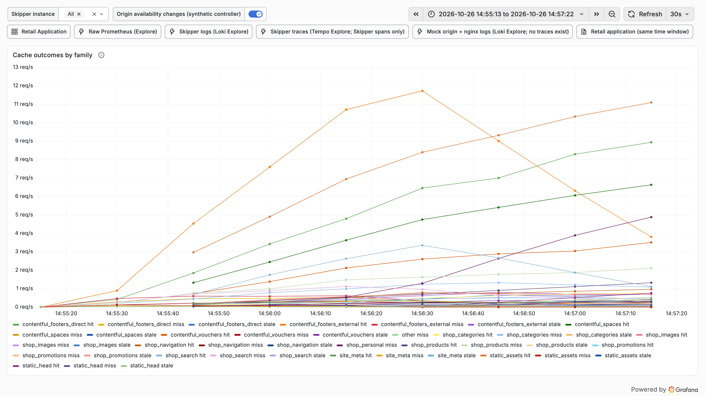

### cache-performance-hit-miss-stale-rate

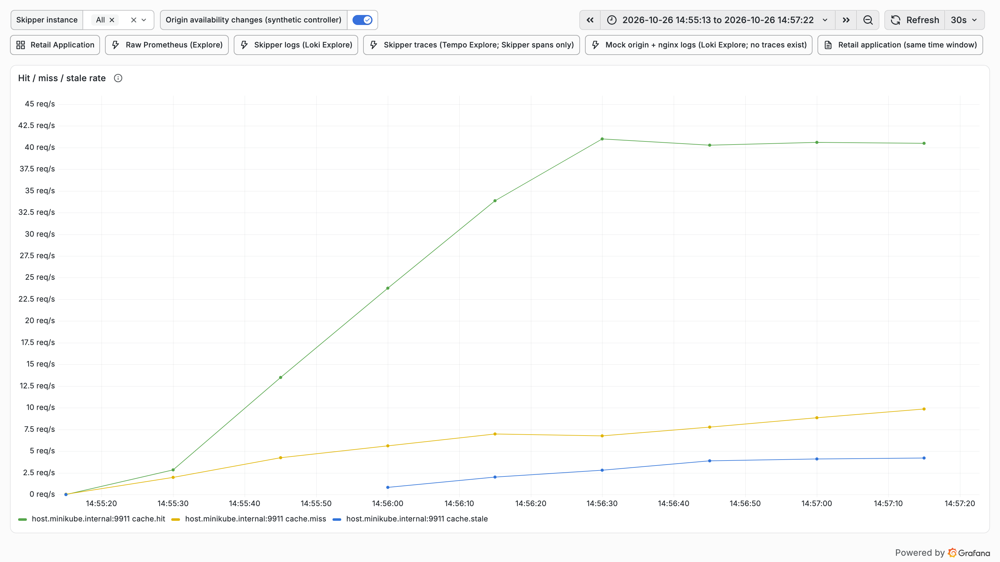

### cache-performance-l1-l2-hit-rate

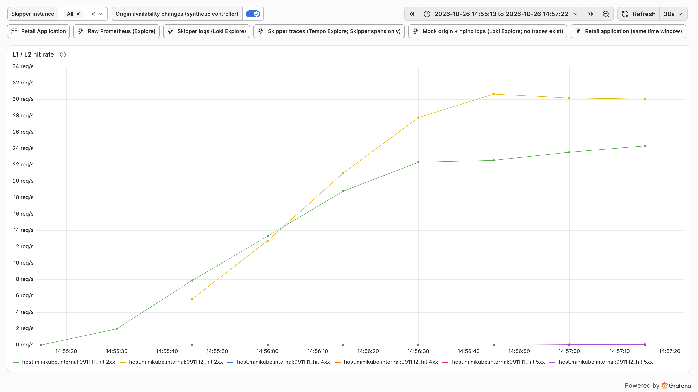

### cache-performance-origin-latency-p95-by-family

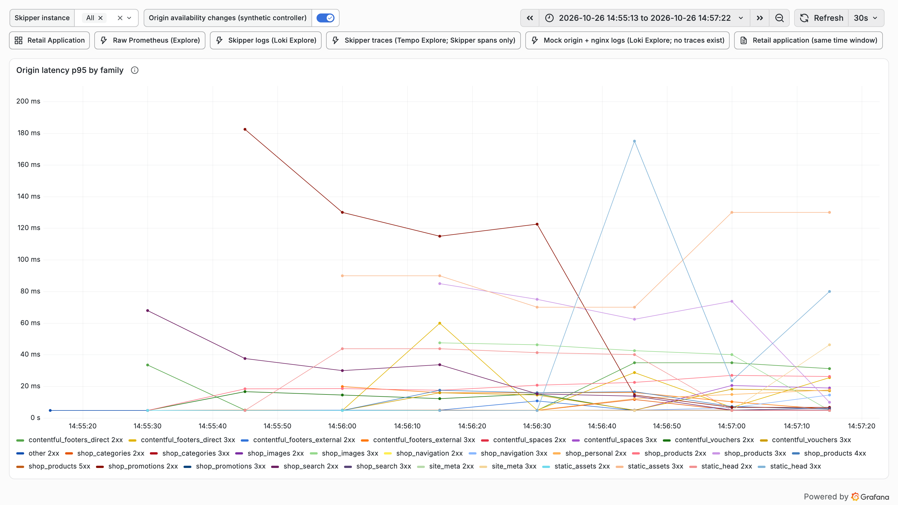

### cache-performance-origin-latency-p95

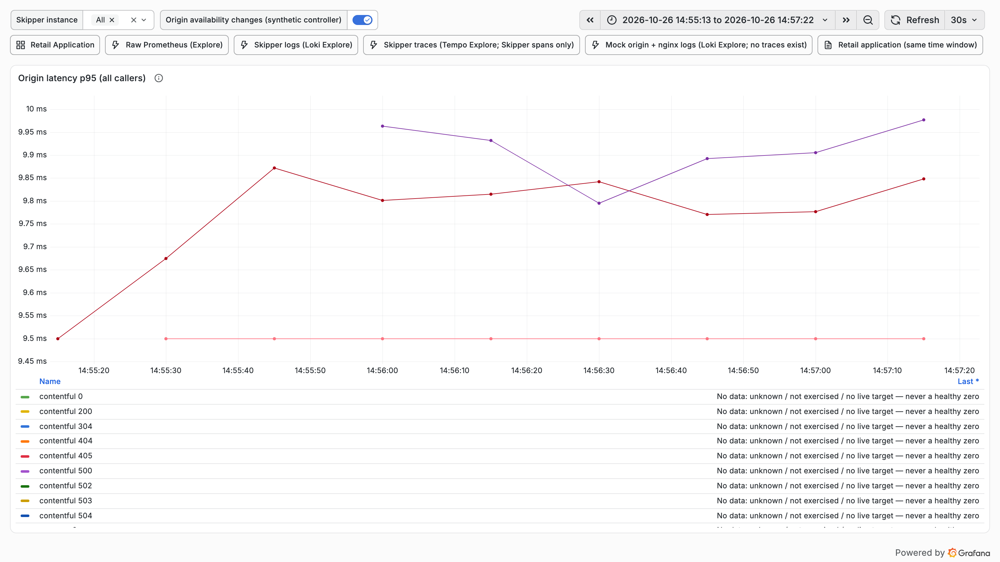

### cache-performance-origin-offload

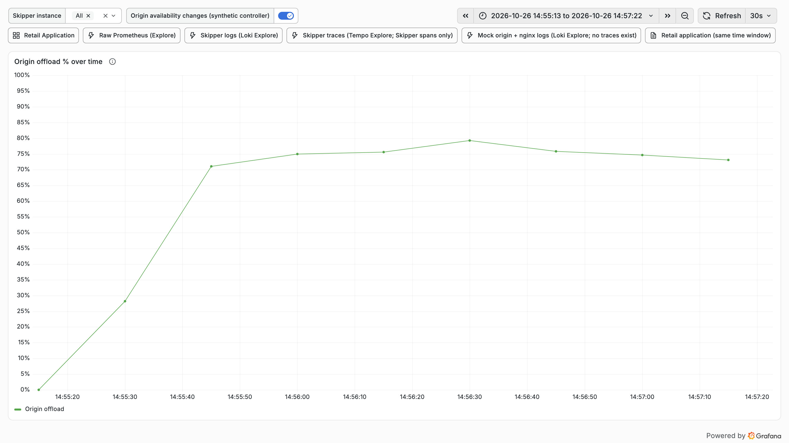

### cache-performance-origin-responses-status

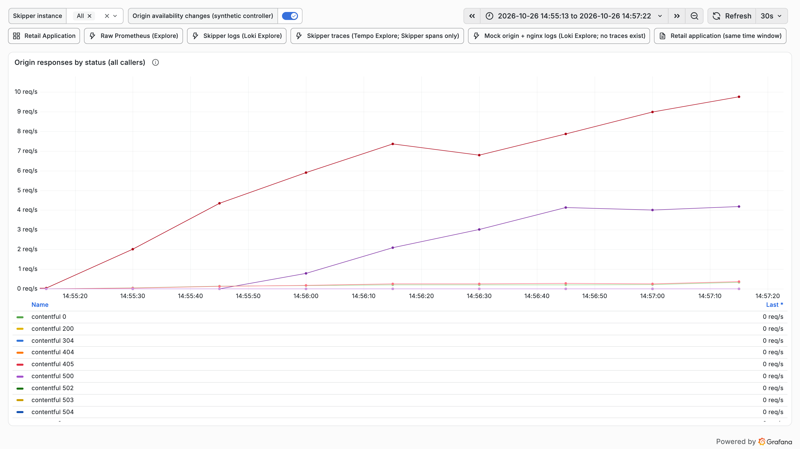

### cache-performance-refresh-errors

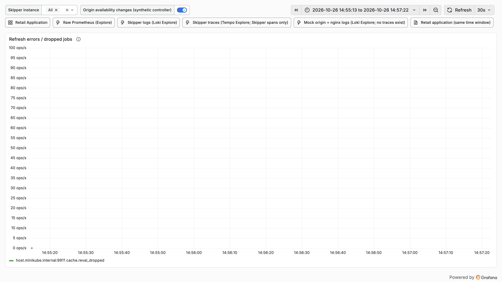

### cache-performance-refresh-outcomes-by-family

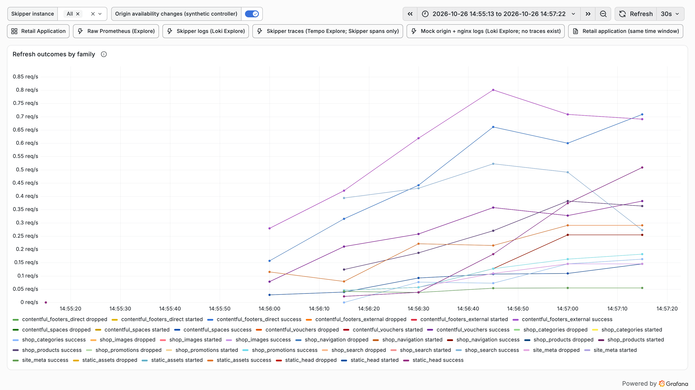

### cache-performance-request-rate

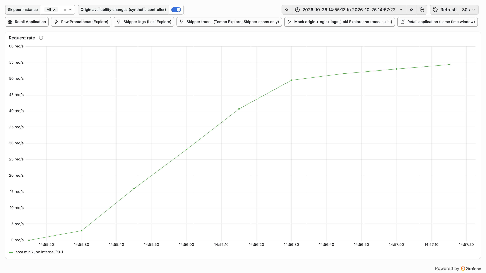

### cache-performance-time-to-first-hit

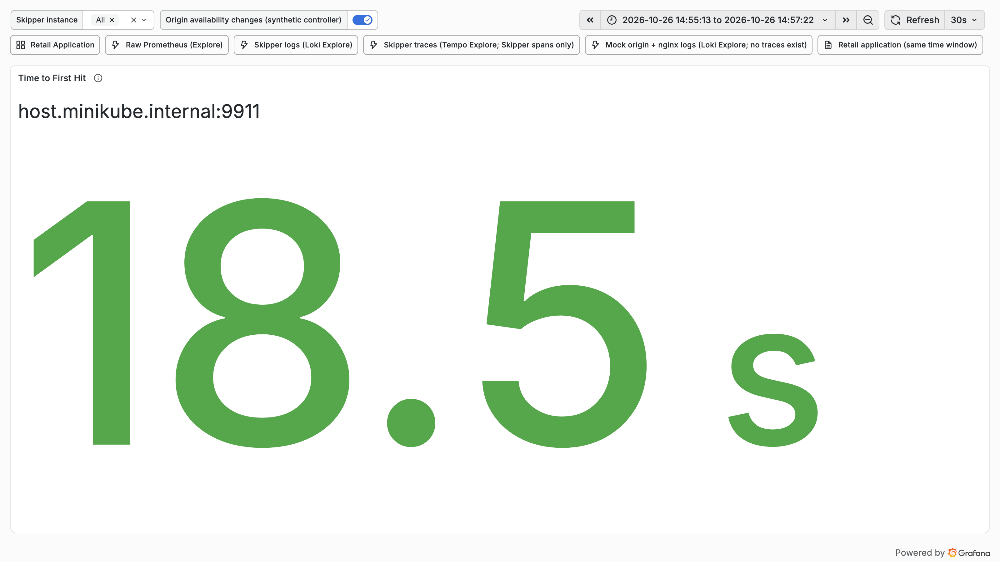

### retail-application-retail-non-2xx

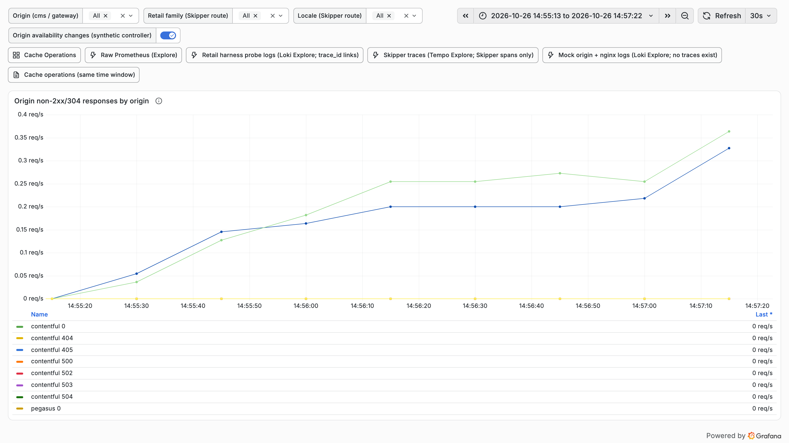

### retail-application-retail-origin-responses

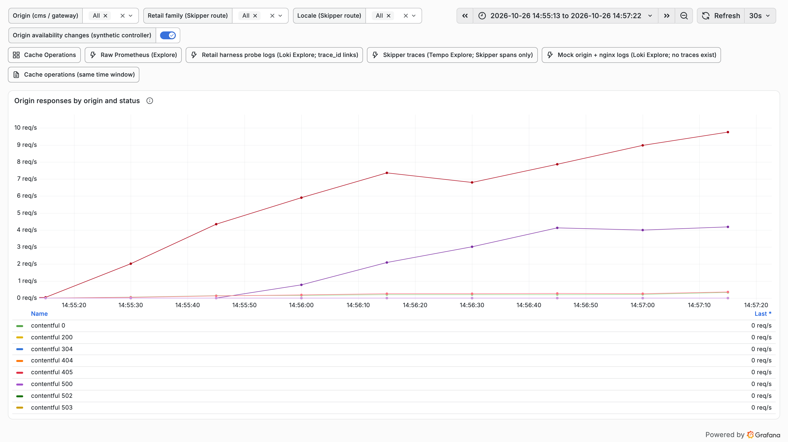
