# Run report: 20261026-152311-origin-stale

- **Scenario:** origin-stale
- **Started:** 2026-10-26T15:23:11+0100
- **Ended:** 2026-10-26T15:28:13+0100
- **Duration:** 5m 01s
- **Max VUs:** 300
- **cache-e2e commit:** b39ae50
- **Skipper SHA:** bda674b0d1574461a30317b2cd154543baa60f65

## Summary

| Requests | Failures | Failure % | Avg (ms) | p50 (ms) | p95 (ms) | p99 (ms) | RPS (avg) |
|---|---|---|---|---|---|---|---|
| 50870 | 16956 | 33.33% | 4.4 | 2.0 | 14.0 | 26.0 | 169.10 |

## Endpoints

| Method | Endpoint | Requests | Failures | Failure % | Avg (ms) | p50 (ms) | p95 (ms) | p99 (ms) | RPS (avg) |
|---|---|---|---|---|---|---|---|---|---|
| GET | swr/contentful_footers_direct | 10870 | 3562 | 32.77% | 2.4 | 1.0 | 8.0 | 17.0 | 36.13 |
| GET | swr/contentful_spaces | 5962 | 3785 | 63.49% | 1.5 | 1.0 | 4.0 | 10.0 | 19.82 |
| GET | swr/shop_products | 5709 | 445 | 7.79% | 5.7 | 4.0 | 17.0 | 28.0 | 18.98 |
| GET | hard/contentful_footers_direct | 3765 | 1205 | 32.01% | 3.1 | 1.0 | 11.0 | 21.0 | 12.52 |
| GET | swr/contentful_footers_external | 3580 | 2000 | 55.87% | 3.9 | 1.0 | 13.0 | 26.0 | 11.90 |
| GET | hard/contentful_spaces | 2184 | 1259 | 57.65% | 1.9 | 1.0 | 6.0 | 15.0 | 7.26 |
| GET | swr/contentful_vouchers | 2130 | 671 | 31.50% | 4.3 | 2.0 | 13.0 | 24.0 | 7.08 |
| GET | swr/shop_categories | 2057 | 290 | 14.10% | 6.7 | 5.0 | 17.0 | 35.0 | 6.84 |
| GET | hard/shop_products | 1920 | 199 | 10.36% | 8.1 | 6.0 | 20.0 | 65.0 | 6.38 |
| GET | hard/contentful_footers_external | 1320 | 705 | 53.41% | 4.9 | 2.0 | 16.0 | 35.0 | 4.39 |

Top 10 of 30 endpoints by request count.

## Failures

| Method | Endpoint | Error | Occurrences |
|---|---|---|---|
| GET | swr/shop_products | CatchResponseError('status') | 445 |
| GET | hard/shop_products | CatchResponseError('status') | 199 |
| GET | swr/shop_search | CatchResponseError('status') | 524 |
| GET | swr/site_meta | CatchResponseError('status') | 80 |
| GET | hard/contentful_vouchers | CatchResponseError('status') | 214 |
| GET | swr/shop_categories | CatchResponseError('status') | 290 |
| GET | swr/shop_images | CatchResponseError('status') | 181 |
| POST | swr/shop_mutations | CatchResponseError('status') | 81 |
| GET | hard/shop_search | CatchResponseError('status') | 194 |
| HEAD | hard/static_head | CatchResponseError('status') | 59 |
| GET | hard/shop_categories | CatchResponseError('status') | 98 |
| GET | hard/shop_promotions | CatchResponseError('status') | 89 |
| GET | hard/contentful_footers_direct | CatchResponseError('status') | 1205 |
| GET | hard/site_meta | CatchResponseError('status') | 26 |
| GET | hard/contentful_spaces | CatchResponseError('status') | 1259 |
| GET | swr/static_assets | CatchResponseError('status') | 327 |
| GET | hard/contentful_footers_external | CatchResponseError('status') | 705 |
| GET | swr/shop_promotions | CatchResponseError('status') | 314 |
| GET | hard/static_assets | CatchResponseError('status') | 101 |
| GET | swr/contentful_vouchers | CatchResponseError('status') | 671 |

8 more rows not shown.

## Exceptions

None recorded.

## Grafana

- [Cache Operations](http://127.0.0.1:55853/d/cache-performance-local?orgId=1&from=1793024591582&to=1793024893073)
- [Retail Application](http://127.0.0.1:55853/d/retail-application-local?orgId=1&from=1793024591582&to=1793024893073)

Time range: `from=1793024591582` to `to=1793024893073` (epoch ms). The base URL is the one in `.runtime/urls.txt` at report time; ports change between runs.

## Panel screenshots

### cache-performance-cache-bytes-vs-capacity

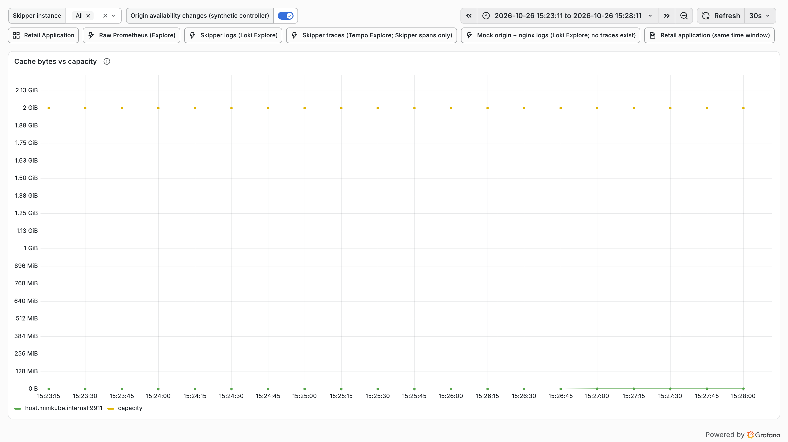

### cache-performance-cache-entries

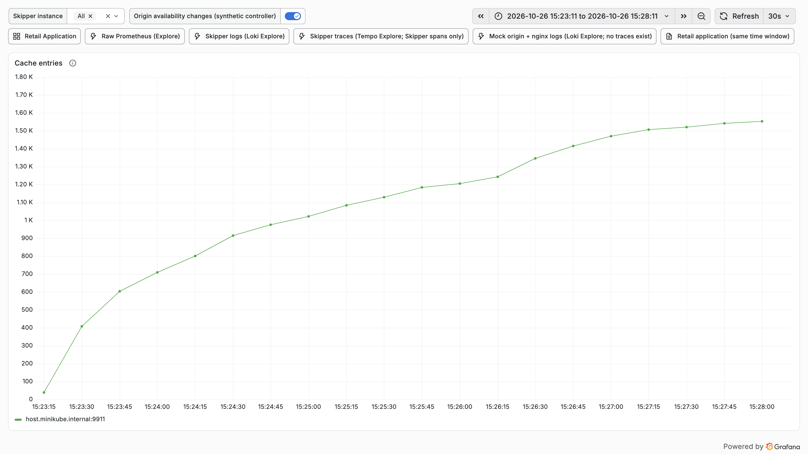

### cache-performance-cache-hit-ratio

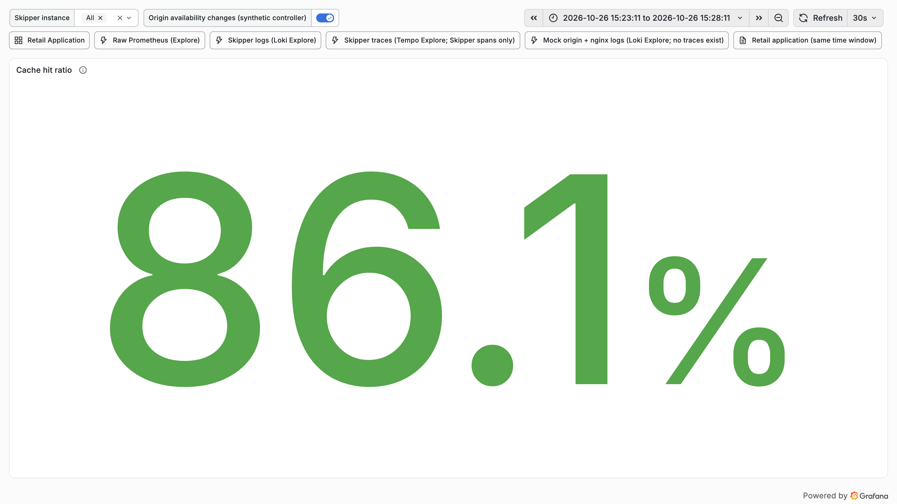

### cache-performance-hit-miss-stale-rate

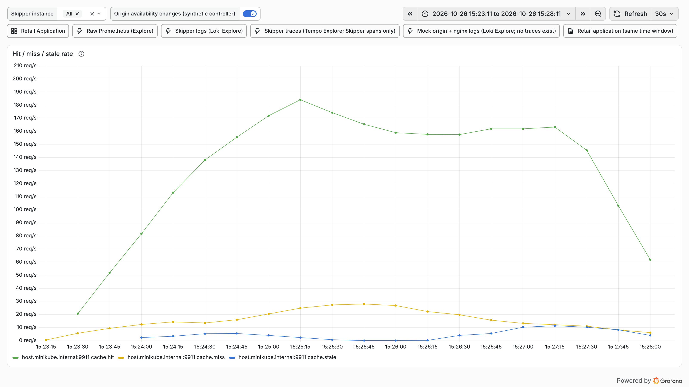

### cache-performance-l1-l2-hit-rate

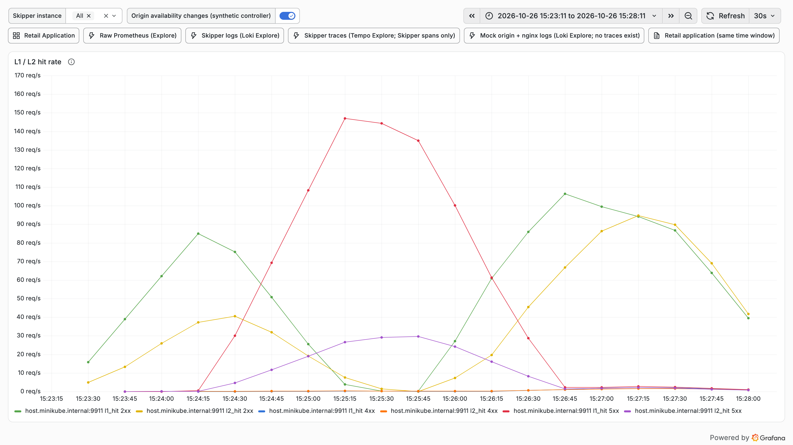

### cache-performance-origin-latency-p95

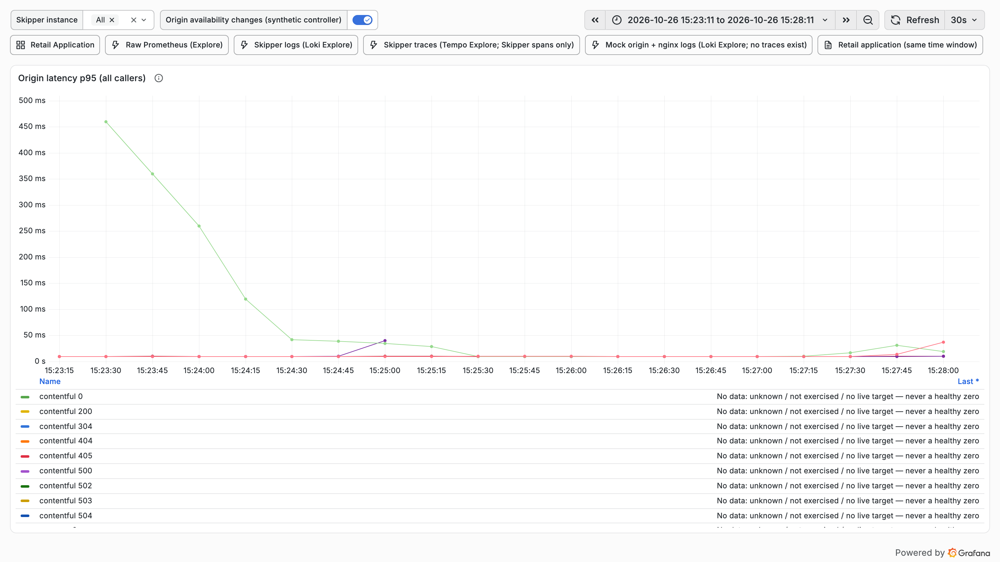

### cache-performance-origin-offload

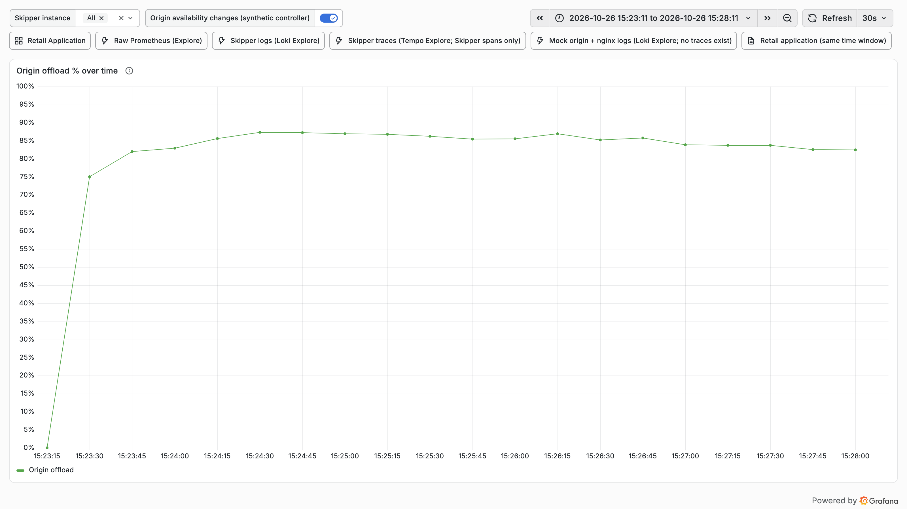

### cache-performance-origin-responses-status

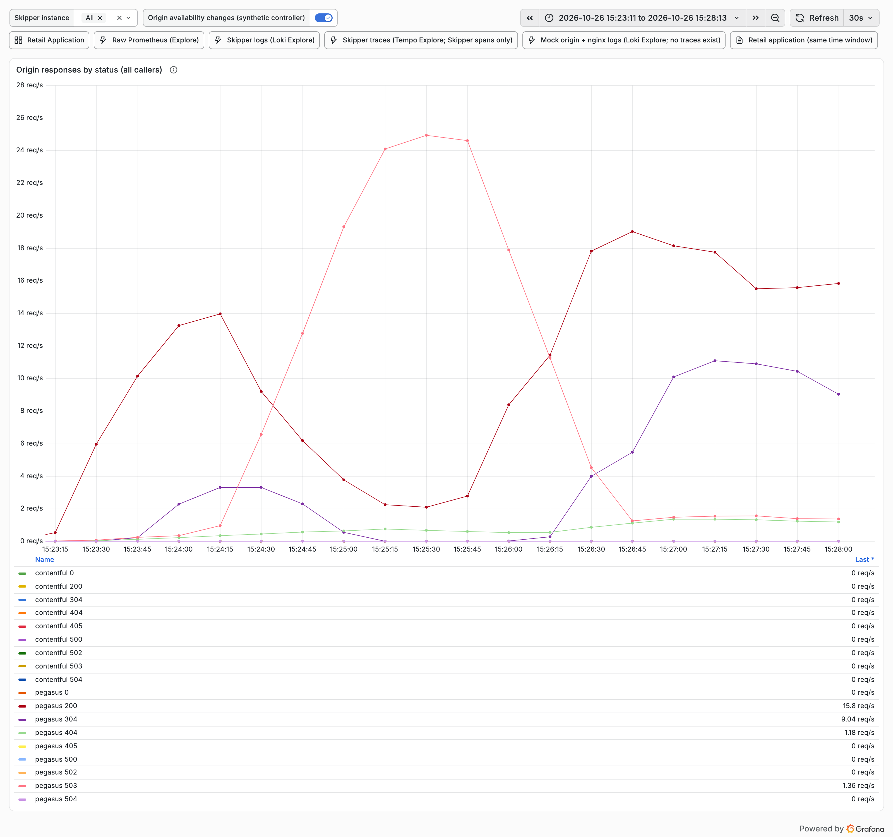

### cache-performance-refresh-errors

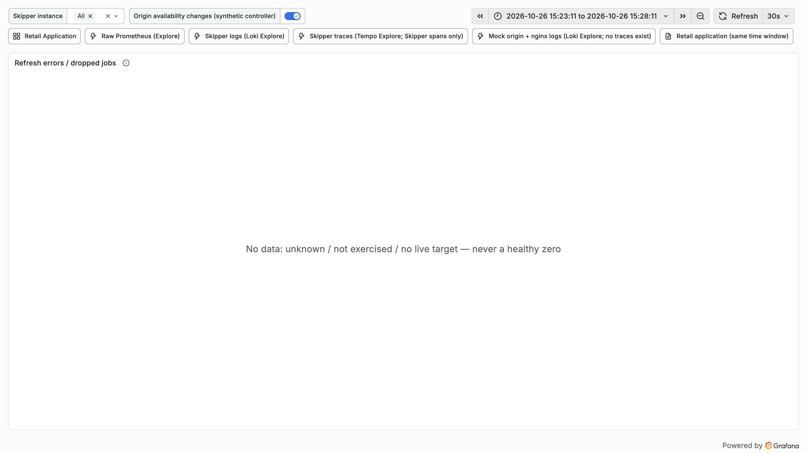

### cache-performance-request-rate

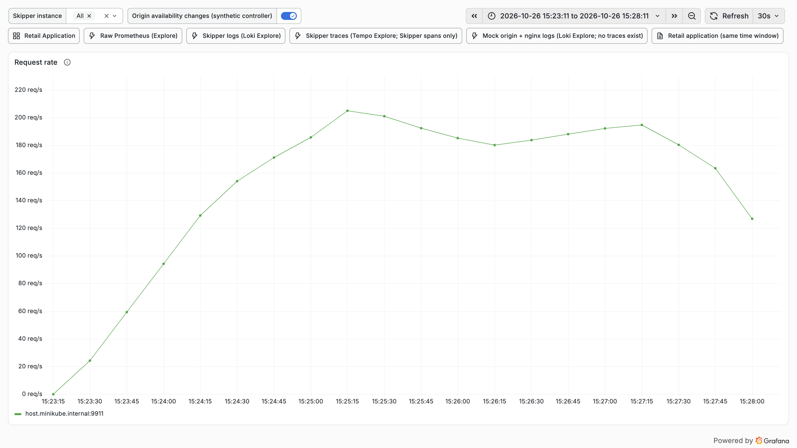

### cache-performance-time-to-first-hit

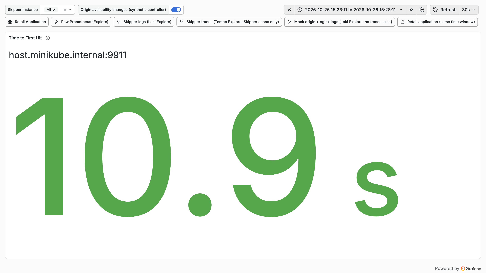

## Fault timeline

| Time | Action | Scheduled offset | Detail |
|---|---|---|---|
| 2026-10-26T15:24:11+0100 | origin-503 | 60s | origin default case status 503 |
| 2026-10-26T15:25:41+0100 | origin-200 | 150s | origin default case status 200 |
| 2026-10-26T15:28:12+0100 | restore |  | origin: origin default case status 200; valkey: valkey up |
